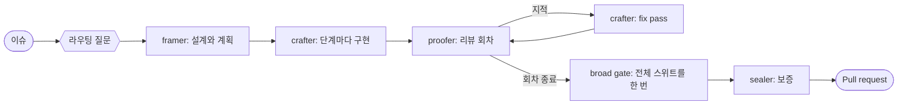
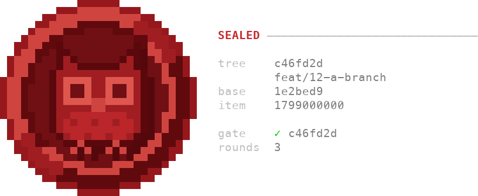

<p align="center">
  
</p>

# AgenticSeal

아무에게도 묻지 않고 변경을 설계하고, 만들고, 검사한 뒤, 커밋 하나에 묶인
seal 을 남기는 에이전트 워크플로입니다.

[](https://github.com/MichaelYcJo/AgenticSeal/actions/workflows/test.yml) · [English](./README.md) · **한국어**

AgenticSeal 은 Claude Code 플러그인입니다. 세션에 이슈 하나를 맡기면, 세션은
시작할 때 질문을 하나 합니다. 이 작업을 어떤 길로 보낼지 묻는 라우팅
질문입니다. `automation` 으로 답하면 그 뒤로는 아무도 다시 묻지 않습니다.
에이전트들이 변경을 설계하고, 만들고, 리뷰하고, 마지막에 seal 을 남깁니다.
seal 은 마지막 에이전트가 쓰는 보증서입니다. 커밋 하나를 기준으로, 작업이
이슈와 트리에 맞는다고 적습니다. 실행은 그 seal 을 기록에 담은 pull request
에서 끝나고, 머지는 하지 않습니다. 머지는 사용자가 합니다.



## 설치

```bash
claude
> /plugin marketplace add MichaelYcJo/AgenticSeal
> /plugin install agentic@agenticseal
```

`git` 과, PATH 에서 `python3` 으로 실행되는 Python 3.12 이상이 필요합니다.
훅(Claude Code 의 이벤트마다 플러그인이 돌리는 스크립트)이 파이썬
스크립트이고, 플러그인은 그 스크립트를 `python3` 명령으로 돌리기 때문입니다.
설치하기 전에 `python3 -V` 를 한 번 돌려 보세요. macOS 의 `/usr/bin/python3`
은 3.9 이고, pyenv 나 asdf 같은 파이썬 버전 관리자를 쓰면 마지막으로 지정한
버전이 나옵니다.
Windows 의 공식 설치본은 `python3` 이라는 이름을 만들지 않으므로, 그곳에서는
훅마다 `py -3` 으로 한 번 더 시도합니다.

설치는 이것으로 끝입니다. `CLAUDE.md` 에는 아무것도 쓰지 않습니다. 자동 포맷
훅은 `uv`, `uvx`, `ruff` 가운데 설치된 것을 쓰고, 하나도 없으면 아무것도 하지
않습니다. 지우려면 `/plugin uninstall agentic` 을 실행합니다.

이 워크플로는 에이전트 하나에게 자기 작업을 리뷰하게 하는 것과 다릅니다. 방금
쓴 것을 리뷰하는 에이전트는 자기 추론을 다시 읽게 되고, 대개 그 추론에 동의합니다.
여기서는 만드는 쪽이 리뷰하거나 seal 을 남기는 쪽이 되는 일이 없습니다. 각
에이전트는 다른 에이전트가 쓴 것을 사실이 아니라 확인할 주장으로 읽습니다
(`skills/core/SKILL.md` *Each agent judges its own target, independently of
the others*).

에이전트가 돌려주는 보고에는 주장마다 라벨이 붙습니다. `executed` 는 명령을
실제로 돌렸다는 뜻이고, `read` 는 코드나 글을 읽었다는 뜻이며, `unverified` 는
아무도 돌리지 않았다는 뜻입니다. `unverified` 인 주장에는 누가 답할지가 함께
적힙니다. 돌지 않은 검사를 통과했다고 보고하는 일은 없습니다.

### 업데이트

```
/agentic:update
```

이 명령은 갱신 명령 두 개를 맞는 순서로 돌린 뒤, 쓰던 버전과 새 버전 사이의
changelog 항목을 알려 줍니다. 동작이 바뀌는 항목과 사용자가 할 일이 있는
항목은 따로 짚습니다. 지금 세션은 시작할 때의 버전을 그대로 씁니다. 새
릴리스를 확실히 쓰려면 Claude Code 를 다시 시작합니다. `/reload-plugins` 가 새
릴리스를 불러온다는 것은 확인된 적이 없고, 그 명령이 무엇을 다시 읽는지 잰
결과는 `docs/experiments/2026-09-03-skill-preload-and-the-copy-in-force.ko.md`
에 있습니다.

손으로 하려면 같은 두 명령을 이 순서로 실행합니다.

```bash
claude plugin marketplace update agenticseal
claude plugin update agentic@agenticseal
```

첫 명령이 마켓플레이스의 사본을 새로 받고, 둘째 명령이 그 사본에서
설치합니다. 둘째 명령만 실행하면 그 사본이 마지막으로 알던 정보를 보고 이미
최신이라고 답합니다. 릴리스는 `plugin.json` 의 버전이 바뀔 때만 사용자에게
닿습니다.

이전 릴리스는 `CLAUDE.md` 의 `<!-- agentic:start -->` 와
`<!-- agentic:end -->` 사이에 블록을 써 넣었습니다. `/agentic:update` 는 그
파일을 백업한 뒤 블록을 들어냅니다. 그런 릴리스에서 업데이트하면 처음에는
`templates/setup/claude-md-block.md` 가 담은 빈 표시 한 쌍이 남을 수 있고,
다음 업데이트가 그것을 지웁니다(`skills/update/SKILL.md`).

## 첫 작업 항목

저장소에서 Claude Code 를 열고, 이슈 하나를 구현해 달라고 평소 말로
부탁합니다. 그러면 그 세션이 orchestrator, 곧 실행 전체를 이끄는 쪽이 됩니다.
orchestrator 는 사람이 정해야 할 것을 묻고, 에이전트를 하나씩 띄우고, 실행의
기록을 관리합니다. 그 기록을 모은 것이 작업 항목이고, 작업 하나마다
`seal/threads/` 아래에 디렉터리가 하나 생깁니다.

세션이 어떤 저장소에서 처음 일할 때는 기록을 어디에 둘지 먼저 묻습니다(아래
*shared 인가 local 인가*). 그다음 라우팅 질문을 합니다. 답은 셋입니다.

- **automation** 은 모든 에이전트가 차례로 돌고, 그 뒤로는 사용자에게 다시
  묻지 않는 길입니다.
- **per axis** 는 네 칸을 하나씩 고르는 길입니다. 실행 도중 사용자에게 물어도
  되는지, crafter 가 만드는지, proofer 가 리뷰하는지, pull request 를 여는지를
  각각 정합니다.
- **no work item** 은 세션이 프레임도 리뷰도 seal 도 없이 직접 고치는
  길입니다.

답마다 무엇이 정해지는지와, 그 답이 `seal/threads/<id>/routing.md` 에 쓰는
행은 `skills/implement/orchestration.md` *Orchestrator: how the work is routed*
에 있습니다. 훅은 이 파일을 읽고 브랜치가 어떤 길로 보내졌는지 압니다.
`automation` 으로 보낸 실행에서는 세션이 사용자에게 하려던 질문이 거절되고,
세션은 그 질문이 내건 기본값으로 계속 만듭니다. 그 기본값은 작업 항목의
`frame/questions.md` 에 적히고, pull request 본문이 그것을 밝혀 사용자가
뒤집을 수 있게 합니다.

그다음 에이전트들이 차례로 일합니다. framer 는 설계를 맡는 에이전트입니다.
저장소를 읽고 설계(design), 계획(plan), 질문(questions)을 씁니다. crafter 는
만드는 에이전트입니다. 계획의 단계(phase)마다 만들고 커밋한 뒤, 무엇을
돌렸고 무엇을 돌리지 않았는지 보고합니다. proofer 는 리뷰하는 에이전트입니다.
커밋된 diff 를 읽고 지적을 회차 기록에 적습니다. crafter 는 fix pass, 곧
지적을 고치는 회차에서 지적마다 답합니다. 회차가 끝나면 세션이 broad gate 를
한 번 돌립니다. broad gate 는 전체 스위트, lint, 타입 검사를 한꺼번에 돌리는
실행입니다. 마지막으로 보증을 맡는 sealer 가 모든 참여자의 기록을 이슈와
트리에 견주어 읽고, 그다음 pull request 가 열립니다.

sealer 의 판정이 `sealed` 이면, 세션은 그 턴이 끝날 때 터미널에 도장을
그립니다. 도장에는 커밋, 브랜치, base, 작업 항목, broad gate 를 돌린 커밋,
리뷰 회차 수가 적힙니다.



도장을 언제 그리고 언제 그리지 않는지는 `docs/checks/the-stamp.md` 에
있습니다.

### shared 인가 local 인가

처음 설정에서 묻는 질문의 답은 셋입니다.

| 답 | `seal/` 이 있는 자리 | 포기하는 것 |
|---|---|---|
| shared, records only (기본값) | `<repo>/seal/`. 커밋한다 | pull request 검사. 따로 더할 때까지 |
| shared, with pull-request checks | `<repo>/seal/` 에 커밋하고, `.github/workflows/hygiene.yml` 도 둔다 | 없다 |
| local | `$(git rev-parse --git-common-dir)/seal/`. git 디렉터리 아래다 | CI, 그리고 빈 채로 시작하는 다른 기계와 다시 받은 클론 |

local 모드는 이 플러그인의 파일이 트리에 있으면 안 되는 저장소에 맞습니다.
회사 저장소나 남의 프로젝트에 기여할 때가 그렇습니다. 무엇을 얻고 무엇을
잃는지는 `docs/layout/one-root-by-lifetime.ko.md` *shared 인가 local 인가* 에
다 있습니다.

**바꾸는 것은 명령 하나입니다.** 명령은 루트를 옮기고 그 이동을 스테이지까지
하며, 커밋은 사용자가 합니다.

```bash
seal mode            # 루트가 어디 있는지, seal/config.md 와 맞는지
seal mode local      # 루트를 트리 밖으로 옮긴다
seal mode shared     # 루트를 트리 안으로 옮긴다
seal mode --check    # 아무것도 쓰지 않고, 둘이 어긋나면 0 이 아닌 값으로 끝난다
```

shared 로 옮겨 커밋하면 기록은 히스토리에 영영 남습니다. 그 커밋 전에
되돌리는 길은 `skills/config/SKILL.md` *Before switching to shared, say what
cannot be undone* 에 있습니다. 손으로 옮기는 두 명령은 루트 안의
`seal/README.md` 에 있고, 처음 설정이 `templates/setup/seal-README.md` 에서 그
파일을 만듭니다.

pull request 검사는 따로 있는 명령입니다.

```bash
seal pr-checks           # .github/workflows/hygiene.yml 이 이 플러그인의 것인지
seal pr-checks install   # 지금 쓰는 릴리스로 고정해 쓰고 스테이지한다
seal pr-checks remove    # 이 플러그인이 쓴 파일을 뺀다
```

local 로 옮긴 뒤에도 워크플로 파일은 트리에 남습니다. 어느 릴리스에 고정된
파일이 그곳에서 통과하는지, 통과하지 못하는 파일의 고정은 어떻게 바꾸는지는
`docs/layout/one-root-by-lifetime.ko.md` *shared 인가 local 인가* 에 있습니다.

local 의 기록은 사용자가 직접 옮기는 사본으로만 다른 기계에 갑니다.

```bash
seal export              # 루트를 클론 옆의 seal-<repo>-<date>.zip 으로 쓴다
seal import <그 zip>     # 사본을 받아 들이고, 아무것도 덮어쓰지 않는다
```

같은 이름의 파일이 이미 있는데 바이트가 다르면, 받은 사본은 그 옆에 놓입니다.
`follow-up.md` 옆의 `follow-up.incoming.md` 가 그 예이고, import 가 그런
파일을 알려 줍니다. zip 이 이 저장소에서 나왔는지 알 수 없으면 import 는
아무것도 쓰지 않고 멈춥니다. 경우마다 쓰는 플래그는 `seal import --help` 가
알려 줍니다. 사본이 동기화가 아닌 이유는
`docs/layout/one-root-by-lifetime.ko.md` *shared 인가 local 인가* 에 있습니다.

## 동작 방식

모든 세션과 모든 에이전트는 코어 `skills/core/SKILL.md` 를 가지고 시작합니다.
코어는 모든 참여자가 판단의 기준으로 삼는 가치를 담은 파일입니다. 나머지는
필요한 단계에서 스킬로 불러오거나, 모델의 컨텍스트 밖에서 훅으로 돕니다.
[컨텍스트 파일에 관한 연구](https://arxiv.org/abs/2602.11988)에 따르면 컨텍스트 파일은
대체로 작업 성공률을 높이지 못하면서 추론 비용을 20% 넘게 늘립니다.

### 누가 무엇을 하나

| 누구/무엇 | 따르는 스킬 | 무엇인가 |
|---|---|---|
| **framer** (서브에이전트) | `core`, `agent-contract` | 아무도 만들기 전에 작업 항목의 설계, 계획, 질문을 쓰고, 코드는 쓰지 않는다 ([`agents/framer.md`](agents/framer.md)) |
| **crafter** (서브에이전트) | `core`, `agent-contract` | 프레임에 맞춰 단계 하나를 만들거나, 리뷰 회차 하나를 놓고 fix pass 를 한 번 돈다 ([`agents/crafter.md`](agents/crafter.md)) |
| **proofer** (서브에이전트) | `core`, `agent-contract` | 커밋된 diff 를 리뷰한다. 프레임을 지켰는지를 먼저 보고 품질을 그다음에 보며, 회차마다 회차 기록을 쓴다 ([`agents/proofer.md`](agents/proofer.md)) |
| **tracer** (서브에이전트) | `core`, `agent-contract` | `seal/parity.md` 를 선언한 저장소에서, 원본 코드가 하는 일을 판정 없이 좌표가 붙은 사실로 기록한다 ([`agents/tracer.md`](agents/tracer.md)) |
| **sealer** (서브에이전트, Opus) | `core`, `agent-contract` | broad gate 뒤에 모든 참여자의 기록을 이슈와 트리에 견주어 읽고, 판정인 `guarantee.md` 를 쓴다 ([`agents/sealer.md`](agents/sealer.md)) |
| 스킬 | — | 에이전트가 첫 호출부터 갖는 스킬은 왼쪽 열에 있다. `code-review`, `commit-pr-convention`, `confidence-check`, `feature-planner`, `implement`, `legacy-parity`, `settle`, `verify`, `writing-style` 은 작업이 요구할 때 세션이 알아서 로드하고, 에이전트는 각 스킬을 그것을 가리키는 단계에서 연다. 나머지는 사용자가 이름을 불러 실행하며, 아래 *명령* 에 있다 |
| 훅 | — | 플러그인이 대신 등록해 주는 스크립트이며, 아래 *내 컴퓨터에서 도는 것* 에 있다 |
| 코어 | — | `skills/core/SKILL.md` 다. 모든 에이전트가 미리 받고, `core-start` 훅이 모든 세션에 출력해 넣으므로 사용자의 `CLAUDE.md` 에는 아무것도 쓰지 않는다. 응답 언어는 정하지 않는다. 세션이 어느 코어를 갖고 있는지는 `! seal core` 로 본다 |

### 리뷰 체인

proofer 는 아무것도 모르는 상태에서 시작합니다. 서브에이전트라서 변경을 만든
대화가 닿지 않고, diff 와 프레임과 앞 회차의 기록만 읽습니다. 회차마다
`trail/rounds/round-N.md` 가 남고, crafter 는 지적마다 고쳤다(fixed), 근거를
들어 받아들이지 않았다(rejected), 정해 둔 곳으로 넘겼다(deferred) 가운데
하나로 닫습니다. 실행은 마지막 수정을 읽는 검증 회차로 끝납니다
(`skills/code-review/orchestration.md` *Orchestrator: the run ends with a
verifying round*). 세션은 회차가 끝날 때마다 한 회차를 더 돌릴 값이 있는지
따지고, 어느 시점에 그것을 따지는지는 `docs/running/the-run.md` *The run* 에
있습니다.

회차가 끝나면 세션이 pull request 가 담을 커밋에서 broad gate 를 한 번
돌립니다. 에이전트는 이것을 돌리지 않습니다. 리뷰 도중에 돌린 전체 실행은
다음 수정이 들어오면 쓸모가 없어지기 때문입니다(`docs/running/the-broad-gate.md`).
sealer 는 broad gate 의 기록과 다른 참여자의 기록을 모두 읽고 판정을 씁니다.
판정은 `sealed`, 트리와 어긋난 곳을 짚은 `withheld`, 사용자에게 묻는 질문을 단
`undecided` 가운데 하나입니다. pull request 는 작업 항목이 `sealed` 를 받은
뒤에 열립니다. pull request 검사를 설치한 곳에서는, 리뷰 준비가 된 pull
request 라도 맨 위 커밋에 seal 이 없거나 마지막 수정을 어느 회차도 읽지
않았으면 검사가 실패합니다(`docs/checks/the-pull-request-check.md`). **체인은
pull request 에서 끝나며, 머지에서 끝나지 않습니다.**

### 기록이 남는 곳

기록은 세션이 아니라 저장소에 남으므로, 다음 세션은 그 기록에서 시작합니다.
`seal/` 에는 `seal/config.md` 처럼 작업 항목보다 오래 사는 것이 있고, 작업
항목마다 그 전부가 `seal/threads/<id>/` 아래에 있습니다. 라우팅 답, 프레임,
단계와 회차의 기록, 마무리 메모, 보증서입니다. 파일 하나하나는
`docs/layout/the-record-layout.md` *seal/* 와 *seal/threads/<work-item-id>/* 에
있습니다. 작업 항목의 설계가 저장소의 `docs/` 정책서와 어떤 관계인지는
`skills/implement/SKILL.md` *Document layout — two roots, three lifetimes* 에
있습니다.

정책서가 적은 규칙은 그 규칙을 지키는 테스트를 가리키는 `check:` 줄로
끝납니다. `seal rules --check` 는 없는 대상을 가리키는 줄이 있으면 0 이 아닌
값으로 끝납니다.

### 마이그레이션

기존 코드베이스의 동작을 옮겨 오는 저장소는 `seal/parity.md` 에 원본과 기준
커밋을 적어 선언합니다. 그러면 판단할 때마다 정책서와 원본, 새 코드를 나란히
놓고 보며, 정책서가 말하지 않는 곳에서는 원본의 동작을 지킵니다. 원본의 사실은
tracer 가 가져옵니다. 세션이 저장소를 처음 설정할 때 한 번 물어보고, 나중에
정하려면 `/agentic:parity-setup` 을 실행합니다. 원본을 체크아웃한 경로는
커밋되는 파일에 들어가지 않고 `~/.claude/agentic/parity-paths.md` 에
저장됩니다. 방법은 `skills/legacy-parity/SKILL.md` 에 있습니다.

## 내 컴퓨터에서 도는 것

훅은 플러그인이 등록하는 스크립트입니다. Claude Code 의 도구 이벤트마다 사용자
컴퓨터에서 돌고, 한 이벤트에 걸린 훅은 프로세스 하나가 모두 처리합니다.
불러오지 못하거나 도중에 멈춘 훅은 건너뛰고 호출은 그대로 진행되며, 어느
훅이었는지는 세션마다 한 번 턴이 끝날 때 알려 줍니다
(`docs/checks/the-session-hooks.md`).

"어디서" 열에 `seal/` 이 적힌 훅은 `seal/` 의 `README.md` 가 플러그인의 표시
줄로 시작하는 저장소에서만 동작하고, 그 밖에서는 아무것도 하지 않습니다.
lint-python 은 프로젝트가 ruff 를 설정한 곳에서만 돕니다. 플러그인을 전역으로
설치하기 전에 "어디서" 열을 먼저 읽어 보세요.

| 게이트 | 언제 | 무엇을 | 어디서 |
|---|---|---|---|
| routing-edit-gate | `Write`, `Edit`, `NotebookEdit` 호출 직전 | 편집하는 파일의 브랜치를 가리키는 `routing.md` 가 없고 이 세션이 그곳에서 `seal no-work-item` 을 돌리지 않았으면 편집을 거부하고, 갈 수 있는 두 길을 알린다. 선언을 쓰거나 그 명령을 돌리는 것이다. `seal/` 아래 파일과 git 이 무시하는 파일은 통과하므로 선언은 언제나 쓸 수 있다. 셸로 한 편집은 이 훅에 닿지 않는다 ([`docs/checks/the-routing-check.md`](docs/checks/the-routing-check.md)) | 루트에 `seal/` 이 있는 저장소, 또는 local 모드로 공통 git 디렉터리 아래에 `seal/` 이 있는 저장소. 그 밖에서는 아무것도 하지 않는다 |
| core-start | 세션 시작, `/clear` 뒤, 압축 뒤. 재개 때는 돌지 않는다 | 코어를 세션에 출력한다. 첫 줄에는 출력한 파일, 플러그인의 버전, 그 파일의 SHA-256 을 적는다. 아무것도 쓰지 않는다 | 모든 세션, 어느 디렉터리에서든 |
| implementer-mark | `subagent_type` 이 `framer` 나 `crafter` 인 Agent 호출 직전 | 브랜치 이름을 `.git/agentic-planner` 나 `.git/agentic-implementer` 에 적는다. 아래 알림이 읽는 흔적이다. 아무것도 출력하지 않는다 | 루트에 `seal/` 이 있는 저장소, 또는 local 모드로 공통 git 디렉터리 아래에 `seal/` 이 있는 저장소. 그 밖에서는 아무것도 하지 않고 아무것도 쓰지 않는다 |
| implementer-notice | `git commit` 을 실행한 명령 직후 | 브랜치의 `routing.md` 가 framer 나 crafter 를 선언했는데 띄웠다는 흔적이 없으면 세션에 한 줄로 알린다. 세션과 저장소마다 한 번이고, 막지 않는다 ([`docs/checks/the-session-hooks.md`](docs/checks/the-session-hooks.md) *The implementer mark and notice*) | 루트에 `seal/` 이 있는 저장소, 또는 local 모드로 공통 git 디렉터리 아래에 `seal/` 이 있는 저장소. 그 밖에서는 아무것도 하지 않는다 |
| review-skill-gate | 모델이 `code-review` 라는 이름의 스킬을 열기 직전 | 어느 것을 뜻하는지 사용자에게 묻는다. 그 이름은 Claude Code 에 내장된 리뷰의 이름이기도 하다. 내장 리뷰는 diff 에서 버그를 훑고, `agentic:code-review` 는 준수를 먼저 판정하고 앞 회차를 읽는다. 세션과 작업 트리마다 한 번 묻는다 | 루트에 `seal/` 이 있는 저장소, 또는 local 모드로 공통 git 디렉터리 아래에 `seal/` 이 있는 저장소. 그 밖에서는 아무것도 하지 않는다 |
| question-gate | `AskUserQuestion` 호출 직전 | `routing.md` 가 `Automation` 에 `yes` 로 답한 브랜치에서는 질문을 거절한다. 그래서 실행은 질문이 내건 기본값으로 진행하고 그 값을 기록한다. 라우팅 질문만 단독으로 물으면 통과한다 ([`hooks/question-gate.py`](hooks/question-gate.py)) | 루트에 `seal/` 이 있는 저장소, 또는 local 모드로 공통 git 디렉터리 아래에 `seal/` 이 있는 저장소. 그 밖에서는, 그리고 선언이 `yes` 로 답하지 않은 브랜치에서는 아무것도 하지 않는다 |
| mode-gate | Bash 호출 직전, 사실상 세션의 첫 명령 | `seal/` 은 있는데 `seal/config.md` 에 `Mode` 행이 없으면 세 선택지로 한 번 묻는다. `seal mode` 는 폴더가 있는 자리를 적어 두고, `seal mode shared` 나 `seal mode local` 은 폴더를 옮긴다. 세션과 저장소마다 한 번이고, 행이 생긴 뒤에는 다시 묻지 않는다 | 루트에 `seal/` 이 있는 저장소, 또는 local 모드로 공통 git 디렉터리 아래에 `seal/` 이 있는 저장소. 그 밖에서는, 그리고 행이 있는 곳에서는 아무것도 하지 않는다 |
| version-check | 세션 시작 시 | 이 저장소에 최신 릴리스 태그를 묻고, 돌고 있는 플러그인이 뒤처져 있으면 `/agentic:update` 와 릴리스를 불러오는 두 방법을 짧게 알린다. 하루에 한 번 묻고, 조회가 실패하면 20분쯤 뒤에 다시 시도한다. 아무것도 설치하지 않는다 | 루트에 `seal/` 이 있는 저장소, 또는 local 모드로 공통 git 디렉터리 아래에 `seal/` 이 있는 저장소. 그 밖에서는 아무것도 하지 않는다 |
| sealer-stamp | 메인 세션의 턴이 끝날 때 (`Stop`) | 작업 항목의 `guarantee.md` 가 `sealed` 로 쓰일 때 남는 도장 가운데 이 세션 앞으로 `<git-common-dir>/agentic-stamp/<session>/` 에 쌓인 것을 그리고, 그 파일의 이름을 `.drawn.json` 으로 바꾼다. 도장은 다음 행의 훅이 작업 항목마다 한 번 쌓는다. 손으로 그리려면 `seal stamp --from <file>` 을 쓴다 | 루트에 `seal/` 이 있는 저장소, 또는 local 모드로 공통 git 디렉터리 아래에 `seal/` 이 있는 저장소. 그 밖에서는 아무것도 하지 않는다 |
| sealer-stamp-queue | 작업 항목의 `guarantee.md` 를 Write 나 Edit 한 직후 | 그 쓰기로 `guarantee.md` 가 `sealed` 로 읽히고 그 판정이 `routing.md` 가 적은 브랜치 위의 커밋을 가리키면, 메인 세션의 `Stop` 이 그릴 도장을 쌓아 두고 쌓은 파일의 경로를 출력한다. 그 브랜치에 그 커밋이 없으면 아무것도 쌓지 않고 거절을 기록한다 | 루트에 `seal/` 이 있는 저장소, 또는 local 모드로 공통 git 디렉터리 아래에 `seal/` 이 있는 저장소. 그 밖에서는 아무것도 하지 않는다 |
| lint-python | `.py` 파일을 Write, Edit, NotebookEdit 한 직후 | 그 파일에 `ruff check --fix` 를 돌린 뒤 `ruff format` 을 돌린다. 레이아웃만이 아니라 코드도 바뀐다. uv, uvx, 전역 ruff 순으로 찾고, 하나도 없으면 아무 말 없이 건너뛴다 | **ruff 를 설정한 프로젝트**. `ruff.toml`, `.ruff.toml`, `pyproject.toml` 의 `[tool.ruff]` 를 저장소 루트까지 거슬러 찾는다. 그 밖에서는 아무것도 하지 않는다 |

다른 세션이 쓰고 있는 작업 트리의 브랜치를 한 세션이 바꾸는 것은 어떤 훅도
막지 않습니다. 동시에 도는 세션에는 각자 worktree 를 하나씩 주세요.

어떤 훅도 사용자의 코드나 경로, 프롬프트를 바깥으로 보내지 않습니다. 다음
부수 효과는 밝혀 둡니다. version-check 는 `~/.claude/agentic/` 아래에 시각
파일을 씁니다. `sealed` 로 읽히는 `guarantee.md` 를 쓸 때 도장에 들어갈 값을
`<git-common-dir>/agentic-stamp/` 아래에 쓰고, 도장 훅은 그린 뒤 그 파일의
이름을 바꿀 뿐 지우지 않습니다. 감사한 커밋이 작업 항목 브랜치에 없어 거절된
`sealed` 는 `<git-common-dir>/agentic-stamp-refused/` 아래에 빈 파일을
남깁니다. 어느 모드에서든 편집 훅이 씁니다. 이 파일도 지우는 것이 없습니다.
lint-python 은 방금 저장한 `.py` 파일을 고쳐 쓰며, ruff 를 설정한
프로젝트에서만 그렇습니다.

네트워크를 타는 훅은 lint-python 과 version-check 입니다. lint-python 이
`uvx ruff` 로 넘어가면 uv 가 처음 한 번 PyPI 에서 ruff 를 내려받습니다.
version-check 는 `seal/` 이 있는 곳에서 하루에 한 번 이 저장소에
`git ls-remote --tags` 를 보내고, 이때 GitHub 은 어딘가의 기계가 AgenticSeal 을
쓴다는 것을 알게 됩니다. 어느 훅이든 네트워크가 없으면 아무 말 없이
넘어갑니다.

## 명령

훅은 저절로 돕니다. 아래는 사용자가 직접 돌리는 것입니다. `seal` 명령은
플러그인이 켜져 있는 동안 Claude Code 의 Bash 도구가 쓰는 PATH 에 있으므로,
세션에서 `!` 뒤에 치거나 세션에게 돌려 달라고 하면 됩니다.

| 명령 | 하는 일 |
|---|---|
| `seal deferrals . [--kind all]` | `unverified` 행이 미뤄 둔 검사를 이곳에서 돌리는 것이 있는지 말하고, 그 검사를 돌리는 CI 파일을 하나씩 짚는다 (`skills/verify/SKILL.md` *The answerer has to exist*) |
| `seal unverified . [--baseline <ref>]` | `unverified` 라벨이 열어 둔 행을, 어느 작업 항목에 있고 누가 답하기로 했는지와 함께 나열한다 (`docs/checks/the-unverified-record.md`) |
| `seal cost --latest` | 세션의 시간이 어디에 쓰였는지 트랜스크립트에서 읽어 알려 준다 (`skills/verify/SKILL.md` *The cost of a run that repeats*) |
| `seal cost --segments <트랜스크립트>` | 실행이 띄운 에이전트마다, 그 에이전트 자신의 트랜스크립트에서 읽은 행을 하나씩 찍는다 (`docs/running/measuring-a-run.md`) |
| `seal settle [--apply]` | 릴리스된 작업 항목의 `frame/design.md` 가 적은 `## Rule changes` 를 절마다 보여 주고, `--apply` 를 주면 정리가 끝난 디렉터리를 지운다 (`skills/settle/SKILL.md` *The settling session's procedure*) |
| `seal fold [--ceiling <n>]` | 정책서마다 한 번에 읽히는 크기인지와 색인이 그 문서를 가리키는지를 `templates/setup/config.md` *The fold's values* 에 견주어 확인한다 |
| `seal rules <doc>` · `seal rules --check` | 문서의 절마다 `check:` 줄이 가리키는 테스트를 찍거나, 대상이 사라진 줄을 하나씩 짚고 0 이 아닌 값으로 끝난다 (`skills/settle/rule-changes.md` *A rule has one shape*) |
| `seal pact [ROOT]` | pact, 곧 여러 저장소가 함께 지키는 계약을 가진 저장소에서, 그 pact 에 서명한 저장소가 모두 아직 그것과 맞는지 확인한다 (`docs/layout/the-pact.md`) |
| `seal core [--transcript <경로>]` | 이 세션의 컨텍스트에 코어가 한 번, 온전히 들어 있는지 알려 준다 (`docs/checks/the-session-hooks.md`) |
| `seal payload` | 세션과 에이전트마다 시작 컨텍스트가 무엇으로 이루어졌는지를 바이트와 토큰으로 잰다 (`skills/verify/scripts/payload_meter.py`) |
| `seal no-work-item` | 체크아웃된 브랜치에서 이 세션이 하는 변경은 어느 작업 항목에도 속하지 않는다고 적어, 편집 훅이 그곳에서 통과시키게 한다 (`skills/commit-pr-convention/SKILL.md`) |
| `/agentic:parity-setup` | 이 저장소가 다른 코드베이스를 옮겨 온다고 선언한다 (`skills/parity-setup/SKILL.md`) |
| `/agentic:config` | 이 저장소가 스스로 정한 것, 곧 두 언어와 기록이 사는 자리를 보여 주고 바꾼다 (`skills/config/SKILL.md`) |
| `/agentic:update` | 최신 릴리스를 받고 무엇이 들어 있는지 알려 준다 (`skills/update/SKILL.md`) |

## 한계

- **훅은 사용자나 모델 앞에 결정을 내놓을 뿐, 보안 장치가 아닙니다.**
  `seal no-work-item` 은 어느 세션이든 돌릴 수 있는 명령 하나이고, 셸로 한
  편집은 편집 훅에 닿지 않으며, 사용자가 터미널에서 직접 한 커밋은 이
  플러그인의 코드를 하나도 돌리지 않습니다.
- **`seal rules --check` 는 적어 둔 테스트가 있다는 것만 증명합니다.** 그
  테스트가 규칙을 확인한다는 뜻은 아닙니다. `check:` 줄이 없는 규칙은 리뷰만
  지킵니다.
- **broad gate 를 한 번만 돌린다는 것은 에이전트가 따르는 규칙이지, 막는
  장치가 아닙니다.** 회차 도중에 세션이 전체 스위트를 돌려도 막는 것은
  없습니다. 되풀이한 실행은 `trail/gate.md` 에 드러나고, proofer 가 crafter 의
  라벨을 확인합니다.
- **`original:` 줄은 누군가 대조했다는 뜻이지, 잘 대조했다는 뜻이 아닙니다.**
  pull request 검사는 대조가 기록되었는지만 읽으므로, 아무도 대조하지 않은
  곳에 적은 줄도 똑같이 읽힙니다.
- **Windows 는 실제 기계에서 한 번 돌았습니다.** 한국어 cp949 콘솔을 쓰는
  네이티브 Windows 11 트리에서 `PYTHONUTF8=1` 없이 스위트가 통과했고,
  `cmd.exe` 로 돌린 훅 진입점도 그곳에서 판정을 돌려주었습니다. `py -3` 폴백은
  Windows 에서 돈 적이 없습니다. POSIX 에서 PATH 의 `python3` 을 없애고
  확인했을 뿐입니다.
- **행동 eval 은 CI 가 아니라 소유자의 계정에서 돕니다.** `evals/behaviour/`
  에는 에이전트 정의를 다시 쓴 것이 출력의 형식을 깨뜨렸는지 잡아내는 스모크
  런의 케이스가 있고, `claude plugin eval` 로 돌립니다. CI 는 그 케이스의
  형식만 봅니다.

## 기여

**풀 리퀘스트는 `main` 이 아니라 열려 있는 `release/vX.Y.Z` 브랜치를 기준으로
엽니다.** 작업은 릴리스 브랜치 하나에 모이고, `main` 은 릴리스마다 한 번만
움직입니다. 플러그인이 배포하는 파일을 건드린 기여를 `main` 으로 열면, 버전을
올리지 않았다는 이유로 CI 가 막습니다.

훅을 고치는 변경은 나머지보다 기준이 높습니다. 훅은 남의 호출을 진행시킬지
말지를 정하기 때문입니다. 고치기 전에 실패하는 것을 직접 본 테스트, 훅이
실패할 때 막는 쪽인지 통과시키는 쪽인지에 대한 설명, 그리고 시험하지 못한
플랫폼은 시험하지 못했다고 밝히는 것이 필요합니다. 나머지는
[CONTRIBUTING.md](./CONTRIBUTING.md) 의 *Opening a pull request* 절에 있습니다.
거기에는 기여에 요구하지 않는 것도 적혀 있습니다. 이 저장소가 스스로에게
적용하는 워크플로는 기여에 하나도 해당하지 않습니다.

## 언어 정책

기능 파일(스킬, 에이전트, 훅)은 영어로만 씁니다. 모델의 컨텍스트에 로드되는
파일이라, 번역본을 따로 두면 원본과 어긋나기 때문입니다. 한국어는
`README.ko.md` 처럼 사람이 읽는 문서에 씁니다. writing-style 스킬 하나는
예외입니다. 언어마다 문장 규칙 절을 따로 담는데, 두 절은 서로의 번역이 아니라
각 언어의 독립된 규범입니다. Claude 가 어느 언어로 답하는지는 사용자 자신의
`CLAUDE.md` 를 따릅니다.

## 라이선스

MIT

AgenticSeal 이라는 이름과 올빼미 문장, 그 인장 그림은 MIT 라이선스를 따르지
않습니다. 어떤 조건을 따르는지는 [TRADEMARKS.md](TRADEMARKS.md) 에 있습니다.
