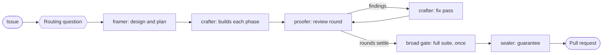

<p align="center">
  
</p>

# AgenticSeal

A workflow of agents that frames, builds, inspects and seals a change, and
ends in a seal bound to a commit.

[](https://github.com/MichaelYcJo/AgenticSeal/actions/workflows/test.yml) · **English** · [한국어](./README.ko.md)

AgenticSeal is a Claude Code plugin. You hand the session an issue, and at
the start it asks you how the work should be routed. Answer
`agentic`, the answer it marks, and the session decides for each item which
agents it needs and whether the run may stop to ask you. Where an item needs
them all, agents frame the change, build it, review it and seal it. Unless
the session made the change itself, as under `direct`, or you asked for the
branch back, the run ends at a pull request whose records carry a seal: the
last agent's written guarantee that the work agrees with the issue and the
tree at one commit. It never merges. Merging is yours.



## Install

```bash
claude
> /plugin marketplace add MichaelYcJo/AgenticSeal
> /plugin install agentic@agenticseal
```

You need `git`, and Python 3.12 or newer answering to `python3` on your PATH.
The `seal` commands are Python scripts, and `python3` is the command they run
with. Run `python3 -V` before you install: macOS ships 3.9 as
`/usr/bin/python3`, and a version manager answers with whatever it was last
told. On Windows, where the official installer creates no `python3`,
`seal.cmd` runs `py -3`, and the plugin's two hooks fall back to it.

That is the whole install. Nothing is written into your `CLAUDE.md` or your
settings, and the plugin's two hooks come with it (*What runs on your
machine*). To uninstall, run `/plugin uninstall agentic`; nothing needs
undoing first.

This workflow differs from asking one agent to review its own work. An agent
reviewing what it just wrote reads its own reasoning back and tends to agree
with it.
Here the party that builds is never the party that reviews or seals, and
each agent reads what the others wrote as claims to check, not as facts
(`skills/core/SKILL.md` *Each agent judges its own target, independently of
the others*).

Every report an agent hands back labels each claim `executed` (it ran the
command), `read` (it read the code or the text) or `unverified` (nobody ran
it), and an `unverified` claim names who answers it. A check that did not run
is never reported as passing.

### Updating

```
/agentic:update
```

It runs the two update commands in the right order, then names the
changelog entries between your version and the new one, and calls out each
one that changes behaviour or asks something of you. The session you are in
keeps the version it started with. Restart Claude Code to load the new
release for certain. `/reload-plugins` is not shown to load it, and
`docs/experiments/2026-09-03-skill-preload-and-the-copy-in-force.md` says
what it was measured to reload.

By hand, the same two commands, in this order:

```bash
claude plugin marketplace update agenticseal
claude plugin update agentic@agenticseal
```

The first refreshes the marketplace's copy and the second installs from it.
The second alone reports that you are at the latest version, against
whatever that copy last knew. A release reaches you only when the version in
`plugin.json` changes.

An update from an earlier release can leave work behind.
`/agentic:update` takes out what an earlier release wrote into your
`CLAUDE.md`, and names what an earlier release left that only you can
remove ([`skills/update/SKILL.md`](skills/update/SKILL.md)). If you update
by hand instead, two things are yours. Run `seal mode` once in each repository that
still holds `seal/config.md`, the settings table earlier releases kept: it
writes `seal/config.json` from the table and removes the old file. Three
files no command converts are rewritten by hand.
`seal/parity.md` becomes `seal/parity.json`, written from
`templates/setup/parity.json`. The `| Signer |` table of a `seal/pact.md`
becomes a `Pact signers` key in that repository's `seal/config.json`, the
remote URLs separated by `;`. `~/.claude/agentic/pact-paths.md` becomes
`~/.claude/agentic/pact-paths.json`, one JSON object from remote URL to
checkout path.

The pull-request checks `seal pr-checks install` wrote clone the release
they were written against, and an update leaves that pin where it is. Run
`seal pr-checks remove` and then `seal pr-checks install` to pin them to the
release you run.

## Your first work item

Open Claude Code in your repository and ask for a change in your own words,
such as "fix #42". The session becomes the orchestrator: it reads the core,
asks what needs a person, spawns each agent, and keeps the run's records.
Those records make up the work item, one directory under `seal/threads/` for
each piece of work. Answering the routing question is your consent to the
agents the run spawns and the tokens they spend. In a repository with a
`seal/` root, the plugin's `SessionStart` hook prints the core into every
session, with a line naming where a request to change code and a request to
review each start. A plain request to change code reaches `implement`, which
sends the session to `skills/implement/orchestration.md`, and a request to
review reaches `code-review`. A session that opened neither
`skills/implement/orchestration.md` nor `code-review` declares nothing and
is outside the workflow.

The first time a session works in a repository, it asks four questions in
one go: where the records should live (*Shared or local*, below), the
command the broad gate runs, the language of commits and pull requests, and
the language of the records. The answers become keys of `seal/config.json`,
and `/agentic:config` changes any of them later. A work item that starts
where either language key is missing asks for both before its first edit.
Then it asks the routing question, every time and even for a typo fix, with
the answer it recommends marked.
The question has four answers, and `agentic` is the one marked:

- **agentic**: the session reads each item's issue and the repository, then
  picks which agents run and whether the run may stop to ask you. A change
  it judges small enough, such as a two-line fix that touches no gate or
  hook, it makes itself as under `direct`. It writes down why it chose each
  route.
- **complete**: every party runs, and the run stops to ask you only what
  only you can decide and would be costly to undo.
- **manual**: four boxes decide whether the run may stop to ask, whether
  the crafter builds, whether the proofer reviews, and whether a pull request
  opens.
- **direct**: the session makes the change itself, with no agent, no frame,
  no review and no seal.

`skills/implement/routing-question.md` gives each answer, and
`skills/implement/orchestration.md` *Orchestrator: how the work is routed*
gives the rows an answer writes into
`seal/threads/<id>/routing.md`, the file the pull request's check reads to
learn how the branch was routed. Where that file's `Automation` row reads
`yes`, as `complete` always writes it and `agentic` may choose it, the
session does not stop to ask what the repository or the framer can answer:
it builds on the question's default, writes the default into the work item's
`frame/questions.md`, and the pull request body names it for you to
overturn. Whatever you say during the run is taken up then, not saved for
the pull request.

Then the parties work in turn. The framer reads the repository and writes
the design, the plan and the questions. A decision made after that, such as
your remark or a review finding that changes the frame, goes back to the
framer, which folds it into the frame before the next agent reads it. The
crafter builds each phase,
commits it, and hands back what it ran and what it did not. The proofer
reviews the committed diff and writes its findings into a round record, and
the crafter answers each finding in a fix pass. Once the rounds settle, the
session runs the broad gate, the full suite, lint and typecheck, once. The
sealer then reads every party's account against the issue and the tree, and
the pull request opens.

When the sealer's verdict is `sealed`, the sealer queues the stamp, and the
plugin's `Stop` hook draws it in your terminal at the end of the session's
turn. It names the commit, the branch, the base, the work
item, the broad gate's commit and the number of review rounds:


Where the hook could not draw it, the sealer's hand-back names
`seal stamp --from <path>`, which draws it by hand.
`docs/checks/the-stamp.md` says when the stamp is drawn and when it is not.

### Shared or local

The first-setup question on where the records live has three answers:

| Answer | Where `seal/` lives | What it gives up |
|---|---|---|
| shared, records only (the default) | `<repo>/seal/`, committed | the pull-request checks, until you add them |
| shared, with pull-request checks | `<repo>/seal/`, committed, and `.github/workflows/hygiene.yml` | nothing |
| local | `$(git rev-parse --git-common-dir)/seal/`, under the git directory | CI, and every other machine and re-clone, which starts empty |

In local mode no pull-request check reads the records, so
`agents/sealer.md` step 1 and the orchestrator's guidance alone hold the
four rows of `skills/core/SKILL.md` *Judgment is not licence to skip a
party*, and that is a limit.

Local mode fits a repository whose tree must not carry this plugin's files,
such as a company repository or a contribution to someone else's project.
`docs/layout/one-root-by-lifetime.md` *Shared or local* gives the whole
trade-off.

Where your repository already has a `seal/` of its own, such as a Python
package, the plugin leaves it alone. Both shared answers then put the root
at `<repo>/agentic-seal/`, and in shared mode every `seal/` this README
names means that folder. Where that name is taken too, only local is
offered.

**Switching is one command.** It moves the root and stages the move, and you
commit it.

```bash
seal mode            # where the root is, and whether seal/config.json agrees
seal mode local      # move the root out of the tree
seal mode shared     # move the root into the tree
seal mode --check    # write nothing; exit non-zero when the two disagree
```

Going to shared puts the records into the history for good. The way back
before that commit is `skills/config/SKILL.md` *Before switching to shared,
say what cannot be undone*. The two moves by hand are in your root's own
`seal/README.md`, which first setup writes from
`templates/setup/seal-README.md`.

The pull-request checks are a command of their own:

```bash
seal pr-checks           # whether .github/workflows/hygiene.yml is this plugin's
seal pr-checks install   # write it, pinned to the release you run, and stage it
seal pr-checks remove    # take out the file this plugin wrote
```

A workflow left behind after a move to local stays in the tree, and
`docs/layout/one-root-by-lifetime.md` *Shared or local* says which pin passes
there and how to move one that fails.

Local records reach another machine only as a copy you carry:

```bash
seal export              # write the root to seal-<repo>-<date>.zip beside the clone
seal import <the zip>    # take a copy in, overwriting nothing
```

Where a file already stands with other bytes, the incoming copy lands beside
it, as `follow-up.incoming.md` beside `follow-up.md`, and the import lists
it. An import refuses, and writes nothing, where it cannot tell that the zip
came from this repository, and `seal import --help` names the flag for each
case. `docs/layout/one-root-by-lifetime.md` *Shared or local* says why a
copy is not a sync.

## How it works

Every agent, and every session in a repository with a `seal/` root, opens
with the core, `skills/core/SKILL.md`, the values every party judges by. The rest
loads at the step that needs it, as a skill, or runs outside the model's
context, as a `seal` command or a pull request's check.
[A study of context files](https://arxiv.org/abs/2602.11988) found that they
generally do not improve task success, and that they add over 20% to the
cost of inference.

### The parties

| Who / what | Follows | What it is |
|---|---|---|
| **framer** (subagent) | `core`, `agent-contract` | Writes the work item's design, plan and questions before anybody builds, and writes no code ([`agents/framer.md`](agents/framer.md)) |
| **crafter** (subagent) | `core`, `agent-contract` | Builds one phase against the frame, or runs one fix pass over a review round ([`agents/crafter.md`](agents/crafter.md)) |
| **proofer** (subagent) | `core`, `agent-contract` | Reviews the committed diff, its compliance with the frame first and its quality second, and writes a round record for each round ([`agents/proofer.md`](agents/proofer.md)) |
| **tracer** (subagent) | `core`, `agent-contract` | Records what an original codebase does, as facts with coordinates and no verdicts, in a repository that declares `seal/parity.json` ([`agents/tracer.md`](agents/tracer.md)) |
| **sealer** (subagent, Opus) | `core`, `agent-contract` | Reads every party's account against the issue and the tree after the broad gate, and writes the verdict, `guarantee.md` ([`agents/sealer.md`](agents/sealer.md)) |
| Skills | — | The skills an agent holds from its first call are in the column to the left. These a session loads on its own when the work calls for them, and an agent opens each at the step that names it: `code-review`, `commit-pr-convention`, `implement`, `legacy-parity`, `settle`, `verify`, `writing-style`. The rest you invoke by name, under *Commands* |
| Core | — | `skills/core/SKILL.md`. Every agent preloads it, and the plugin's `SessionStart` hook prints it into each session in a repository with a `seal/` root, so nothing is written into your `CLAUDE.md`. It sets no response language |

### The review chain

The proofer starts cold. It is a subagent, so the conversation that built the
change never reaches it: it reads the diff, the work item's records whole
(the frame, `gaps.md`, `changelog.md` and `pr.md` among them) and the
earlier round records. Each round writes `trail/rounds/round-N.md`, and the
crafter closes each finding as fixed, rejected with its grounds, or deferred
to a named home. The run ends with a verifying round, which reads the last
fixes and the work item's records again
(`skills/code-review/orchestration.md` *Orchestrator: the run ends with a
verifying round*). The session weighs after each round whether another one
pays, and `docs/running/the-run.md` *The run* gives the point where it
weighs that.

After the rounds, the session runs the broad gate once: the full suite, lint
and typecheck, at the commit the pull request will carry. No agent runs it,
because a full run taken mid-review is spent by the next fix
(`docs/running/the-broad-gate.md`). The sealer reads the gate's record and
every other party's, checks that the pull request body `seal pr-body` wrote
is `pr.md` and the records' own text, and writes `sealed`, `withheld` with
what the tree contradicts, or `undecided` with a question for you. The pull
request opens once the work item is sealed, and its body carries the seal
mark where the `Pull request seal mark` key reads `yes`. Where the two
language keys name different languages, the body opens with `pr.<lang>.md`,
written in the pull request language. Where the pull-request checks are
installed, they fail a ready pull request that lacks the seal at
its head commit, whose last fixes no round read, or whose body is not what
`seal pr-body` composes at that commit (`skills/core/SKILL.md` *Judgment is
not licence to skip a party*). **The chain ends at a pull request, never at
a merge.**

### Where the records live

The records live in the repository, not in the session, so the next session
starts from them. `seal/`, the folder *Shared or local* above places, holds
what outlives a work item, such as `seal/config.json`, and each work item
whole under `seal/threads/<id>/`: its
routing answer, its frame, the trail of its phases and rounds, its closing
memo and its guarantee. `docs/layout/the-record-layout.md` *seal/* and
*seal/threads/<work-item-id>/* name every file. How a work item's design
relates to the policy documents your repository keeps under `docs/` is
`skills/implement/SKILL.md` *Document layout — two roots, three lifetimes*.

A rule a policy document states ends with a `check:` line naming the test
that holds it, and `seal rules --check` exits non-zero on a target that does
not exist.

### Migrations

A repository that ports behaviour from an existing codebase declares
`seal/parity.json`, naming the original and its baseline commit. Each
judgment then weighs the policy, the original and the new code, and the
original's behaviour is kept where the policy says nothing. The tracer
fetches the original's facts. The frame lists what the original sends from
each entry point the work ports, and the review walks from the original to
the port, so an item the original sends and the port leaves out is a
finding even where the design never named it. Your session asks about it
once, the first time it sets up a repository, and `/agentic:parity-setup`
decides it later.
Your checkout path of the original stays out of the committed file, in
`~/.claude/agentic/parity-paths.json`. `skills/legacy-parity/SKILL.md` is the
method.

## What runs on your machine

What runs on your machine is a `seal` command you or the session starts,
and the plugin's two hooks, which Claude Code runs at its own events.

**The plugin ships two hooks, registered in `hooks/hooks.json`, and neither
writes into your settings.**

- **`SessionStart`**, at a session's start and again after `/clear` or a
  compaction, runs `hooks/core-start.py`. Where the session's repository
  holds a `seal/` root, it prints `skills/core/SKILL.md` into the session's
  context, under one line naming the plugin's version and above one line
  naming where work starts. Anywhere else it prints nothing.
- **`Stop`**, at the end of each turn of the main session, runs
  `seal_stamp.py --stop`, which draws each stamp waiting in the clone the
  session works in, once, and says nothing where none waits.

Each command is `python3 "<script>" || py -3 "<script>" || exit 0`, with
the script under the plugin's own directory, so an update moves both hooks
with it. The closing `exit 0` makes each command exit 0 whatever happens,
so neither hook ever stops a turn. A release from 0.33.0 to 0.34.1 may have
left a launcher of its own that also runs at the end of each turn, and
`/agentic:update` names it for you to remove
([`skills/update/SKILL.md`](skills/update/SKILL.md) *4b. The launcher an
earlier release wrote*).

No session stops another from switching the branch of a working tree it is
using, so give each concurrent session its own worktree.

The agents run their commands through Claude Code's Bash tool, under your
permission settings. A command line Claude Code's parser cannot read is held
for you to approve, and the run waits until you answer, so every agent
writes plain POSIX syntax that bash and zsh read the same way
(`skills/agent-contract/SKILL.md` rule 21). An agent keeps its scratch
files in a directory of its own under `<scratchpad>/<work-item-id>/`, and
the crafter keeps one for each phase and each fix pass. No agent removes its
directory or the session's scratchpad. The orchestrator removes the work
item's directory once the pull request is open, and again after each later
repair of it.

Neither hook sends your code, your paths or your prompts anywhere: what the
`SessionStart` hook prints goes into the session's own context, as a file
the session opens does. These side effects are worth stating outright: the sealer's
`seal stamp --guarantee`, run once on a `guarantee.md` reading `sealed`,
writes the stamp's values under `<git-common-dir>/agentic-stamp/`, which the
stamp's hook renames once drawn and nothing prunes, and a `sealed` refused
because its audited commit is not on the work item's branch leaves an empty
file under `<git-common-dir>/agentic-stamp-refused/`, in either mode, which
nothing prunes either.

Neither hook reaches a network. The places below do: each is a command
or a step of the workflow, so it runs when you or the session starts it, or,
in the last row, in your CI on a pull request.

| What | Reaches | Sends | When |
|---|---|---|---|
| `/agentic:update` ([`skills/update/SKILL.md`](skills/update/SKILL.md)) | GitHub | `claude plugin marketplace update` pulls the marketplace's clone of this repository, and `claude plugin update` installs from that clone. Then one `curl`, with no token, reads the list of releases from GitHub's public API for the repository the clone came from | when you run the command |
| `seal cost --post` ([`docs/running/measuring-a-run.md`](docs/running/measuring-a-run.md)) | your repository's issues, through your `gh` login | `gh issue list` for the issues labelled `flow-measurement`, then one `gh issue comment` on the one open issue with that label. The comment holds the orchestrator's sentence and the agent's numbers, and names each transcript the numbers were read from by its file name, never by its path. With `--work-item`, it also names the work item's directory and branch, and the directory of each other work item a segment's spawn prompt also names, read from the records directory and from every local branch, pushed or not. It holds no command text: its slowest calls are listed by seconds and family alone. With `--work-item`, posting or not, it first reads every comment of that issue with `gh api --paginate`. It never opens an issue | with `--work-item`, when a work item's run ends, where the orchestrator runs it, and again at a release, before the release pull request merges, for each work item it ships; and whenever you type it. Nothing is posted where no issue of your repository has ever carried the label, or where `gh` is missing |
| `seal gate`, the broad gate ([`skills/verify/scripts/broad_gate.py`](skills/verify/scripts/broad_gate.py)) | your repository's pull request, through your `gh` login | `gh pr view --json isDraft`, asked by its `chain_check.py` step to learn whether the branch's pull request is a draft. `chain_check.py` run on its own asks the same | each run outside GitHub Actions, where `gh` is on the PATH |
| `seal settle` ([`skills/settle/SKILL.md`](skills/settle/SKILL.md)) | your repository's releases and pull requests, through your `gh` login | `gh api --paginate` of the repository's releases. In local mode, also `gh pr list --head <branch> --state merged`, once per branch | the releases, when a released work item's directory holds a changelog and is about to be removed, to find its release note. The pull requests in local mode, to learn which branches merged |
| the workflow's own steps ([`skills/code-review/orchestration.md`](skills/code-review/orchestration.md)) | your repository, through your `git` and your `gh` login | reads the issue with its comments, and the latest release note. Pushes the work item's branch, opens the pull request with `gh pr create`, rewrites its body, reads its state and checks, and may start a workflow run. Lists recent pull requests before a commit, and beside the two language questions. At a settle, may open an issue for a measurement | the issue is read in every run. The push and the pull request happen only where the routing answers that a pull request opens |
| the pull-request checks `seal pr-checks install` writes (`.github/workflows/hygiene.yml`) | GitHub, from your CI runner | `git clone --depth 1` of this plugin's repository, at the release the file was written against | on each pull request, in a repository that installed the checks |

The two hooks are the only things on your machine that run without you or
the session starting them. Each row above that goes through your own `gh` login
reaches the repository you work in and no other. The workflow's steps push
your branch, with its code, and the pull request's text there, because that
is what they are for.

## Commands

These you run. The `seal` commands are on the
PATH of Claude Code's Bash tool while the plugin is enabled, so you type one
after `!` in a session, or ask the session to run it.

| Command | Does |
|---|---|
| `seal deferrals . [--kind all]` | says whether anything here runs the check an `unverified` row defers, and names each CI file that does (`skills/verify/SKILL.md` *The answerer has to exist*) |
| `seal unverified .` | lists the rows the `unverified` labels left open, in which work item, and who was named to answer each (`docs/checks/the-unverified-record.md`) |
| `seal cost --latest` | says where a session's minutes went, from its transcript (`skills/verify/SKILL.md` *The cost of a run that repeats*) |
| `seal cost --segments <transcript>` | gives one row per agent a run spawned, read from that agent's own transcript (`docs/running/measuring-a-run.md`) |
| `seal cost --work-item <dir>` | gives one row per segment of a work item that no comment on the open measurement log names, found by its spawn prompt naming the work item's directory or branch; with `--post --says <file>` it posts them (`skills/verify/orchestration.md` *Measure the run, and feed the flow log*) |
| `seal settle [--apply]` | shows the `## Rule changes` the released work items' `frame/design.md` files state, by section, and with `--apply` removes the settled directories (`skills/settle/SKILL.md` *The settling session's procedure*) |
| `seal fold [--ceiling <n>]` | checks that each policy document is short enough to read whole and that its index names it, against the `Document token ceiling` and `Policy root` keys of `seal/config.json` (`templates/setup/config.md` *The fold's values*) |
| `seal rules <doc>` · `seal rules --check` | prints a document's sections with the tests their `check:` lines name, or exits non-zero naming each line whose target is gone (`skills/settle/rule-changes.md` *A rule has one shape*) |
| `seal pact [ROOT]` | checks, in the repository that holds a pact, that every repository signed to it still agrees with it (`docs/layout/the-pact.md`) |
| `seal payload [--json] [--agent <name>] [--root <dir>]` | measures what a session's and each agent's startup context is made of, in bytes, with the tokens estimated from the bytes (`skills/verify/scripts/payload_meter.py`) |
| `/agentic:parity-setup` | declares that this repository ports from another codebase (`skills/parity-setup/SKILL.md`) |
| `/agentic:config` | shows every key of `seal/config.json`, which holds what this repository decided for itself, such as its two languages, where its records live and the command its broad gate runs, and changes any of it (`skills/config/SKILL.md`) |
| `/agentic:update` | takes the newest release and names what is in it (`skills/update/SKILL.md`) |

## Limits

- **Nothing refuses a session that declares nothing.** A session that never
  opened `skills/implement/orchestration.md` edits and commits as it would
  without the plugin,
  and a commit you make yourself in a terminal runs none of this plugin's
  code. The pull request's check judges a declared work item
  ([`docs/checks/the-routing-check.md`](docs/checks/the-routing-check.md)).
- **`seal rules --check` proves that a named test exists, not that it asserts
  the rule.** It reads no rule without a `check:` line. In a policy document
  such a rule is held by review alone. The agent definitions and the contract
  carry no line at all, so the command reads none of their rules: a rule there
  is held by the cases that read it where any do, and by review alone where
  none does (`skills/settle/rule-changes.md` *A rule has one shape*).
- **"Broad and once" is a rule the agents follow, not a gate.** Nothing stops
  a session from running the full suite mid-round. `trail/gate.md` makes a
  repeat visible, and the proofer audits the crafter's labels.
- **An `original:` line says that someone compared, not that they compared
  well.** The pull-request check reads that a comparison was recorded, and
  a line written where nobody compared reads the same.
- **Windows was run on real hardware once.** The suite passes on a native
  Windows 11 tree, on a Korean cp949 console, with no `PYTHONUTF8=1`. The
  plugin's two hooks have not run on Windows, and neither has their `py -3`
  fallback.
- **The behaviour evals run on the owner's account, not in CI.**
  `evals/behaviour/` holds the cases of a smoke run, through
  `claude plugin eval`, that catches a rewrite of an agent's definition
  breaking the shape of its output. CI checks their shape.

## Contributing

**Base your pull request on the open `release/vX.Y.Z` branch, not on `main`.**
Work collects on one release branch, and `main` moves once per release.
A contribution aimed at `main` that touches what the plugin ships is refused
by CI for leaving the version alone.

A change to a gate carries a higher bar than the rest of the tree, because a
gate decides whether someone's pull request or run goes ahead: a test seen
failing before the fix, a stated failure direction, a count of the questions
it puts to a person, honesty about the platforms you could not test, and the
existing mechanism it removes, or why none can go.
[CONTRIBUTING.md](./CONTRIBUTING.md) *What a change to
a gate must carry* is the whole of it, and *Opening a pull request* holds the
rest, including what a contribution is not asked for: none of this
repository's own workflow applies to one.

## Language policy

Functional files (skills, agents, scripts) are English only, because they load
into the model's context and a translated copy would drift. Korean is for
documents people read, such as `README.ko.md`. The writing-style skill is the
one exception: it carries a section of prose rules for each language, and
the two are independent norms, not translations. The language Claude answers
you in follows your own `CLAUDE.md`. The language of the commits, pull
requests and records the workflow writes in your repository is that
repository's own: the two language keys of `seal/config.json`.

## License

MIT

The AgenticSeal name, the owl emblem and its seal drawings are not under
the MIT License; [TRADEMARKS.md](TRADEMARKS.md) says what they are under.
