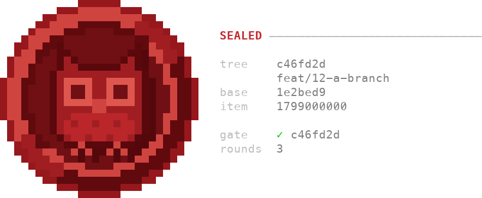

<p align="center">
  
</p>

# AgenticSeal

A workflow of agents that frames, builds, inspects and seals a change without
asking anyone, and ends in a seal bound to a commit.

[](https://github.com/MichaelYcJo/AgenticSeal/actions/workflows/test.yml) · **English** · [한국어](./README.ko.md)

AgenticSeal is a Claude Code plugin. You hand the session an issue, and it
asks you one question at the start: how the work should be routed. Answer
`automation`, and nothing stops to ask you again. Agents then frame the
change, build it, review it and seal it. The run ends at a pull request whose
records carry a seal: the last agent's written guarantee that the work agrees
with the issue and the tree at one commit. It never merges. Merging is yours.


## Install

```bash
claude
> /plugin marketplace add MichaelYcJo/AgenticSeal
> /plugin install agentic@agenticseal
```

You need `git`, and Python 3.12 or newer answering to `python3` on your PATH.
The hooks are Python scripts, and `python3` is the command the plugin runs
them with. Run `python3 -V` before you install: macOS ships 3.9 as
`/usr/bin/python3`, and a version manager answers with whatever it was last
told. On Windows, where the official installer creates no `python3`, each
hook falls back to `py -3`.

That is the whole install. Nothing is written into your `CLAUDE.md`. The
auto-format hook uses `uv`, `uvx` or `ruff` where one is installed, and does
nothing where none is. To uninstall, run `/plugin uninstall agentic`.

This workflow differs from asking one agent to review its own work. An agent
reviewing what it just wrote reads its own reasoning back and tends to agree
with it.
Here the party that builds is never the party that reviews or seals, and
each agent reads what the others wrote as claims to check, not as facts
(`skills/core/SKILL.md` *Each agent judges its own target, independently of
the others*).

Every report an agent hands back labels each claim `executed` (it ran the
command), `read` (it read the code or the text) or `unverified` (nobody ran
it), and an `unverified` claim names who answers it. A check that did not run
is never reported as passing.

### Updating

```
/agentic:update
```

It runs the two update commands in the right order, then names the
changelog entries between your version and the new one, and calls out each
one that changes behaviour or asks something of you. The session you are in
keeps the version it started with. Restart Claude Code to load the new
release for certain. `/reload-plugins` is not shown to load it, and
`docs/experiments/2026-09-03-skill-preload-and-the-copy-in-force.md` says
what it was measured to reload.

By hand, the same two commands, in this order:

```bash
claude plugin marketplace update agenticseal
claude plugin update agentic@agenticseal
```

The first refreshes the marketplace's copy and the second installs from it.
The second alone reports that you are at the latest version, against
whatever that copy last knew. A release reaches you only when the version in
`plugin.json` changes.

Earlier releases wrote a block into `CLAUDE.md` between
`<!-- agentic:start -->` and `<!-- agentic:end -->`. `/agentic:update` backs
the file up and takes the block out, and an update from such a release may
first leave the empty marker pair `templates/setup/claude-md-block.md`
holds, which the next update removes (`skills/update/SKILL.md`).

## Your first work item

Open Claude Code in your repository and ask it to implement an issue, in your
own words. The session becomes the orchestrator: it asks what needs a person,
spawns each agent, and keeps the run's records. Those records make up the
work item, one directory under `seal/threads/` for each piece of work.

The first time a session works in a repository, it asks where the records
should live (*Shared or local*, below). Then it asks the routing question,
which has three answers:

- **automation**: every party runs, and nothing stops to ask you again.
- **per axis**: four boxes decide whether the run may stop to ask, whether
  the crafter builds, whether the proofer reviews, and whether a pull request
  opens.
- **no work item**: the session makes the change itself, with no frame, no
  review and no seal.

`skills/implement/orchestration.md` *Orchestrator: how the work is routed*
gives each answer and the rows it writes into
`seal/threads/<id>/routing.md`, the file the hooks read to learn how the
branch was routed. Under `automation`, a question the session would put to
you is refused, and the session builds on the default the question states.
The default is written into the work item's `frame/questions.md`, and the
pull request body names it for you to overturn.

Then the parties work in turn. The framer reads the repository and writes
the design, the plan and the questions. The crafter builds each phase,
commits it, and hands back what it ran and what it did not. The proofer
reviews the committed diff and writes its findings into a round record, and
the crafter answers each finding in a fix pass. Once the rounds settle, the
session runs the broad gate, the full suite, lint and typecheck, once. The
sealer then reads every party's account against the issue and the tree, and
the pull request opens.

When the sealer's verdict is `sealed`, the session draws the stamp in your
terminal at the end of its turn. It names the commit, the branch, the base,
the work item, the broad gate's commit and the number of review rounds:



`docs/checks/the-stamp.md` says when the stamp is drawn and when it is not.

### Shared or local

The first-setup question has three answers:

| Answer | Where `seal/` lives | What it gives up |
|---|---|---|
| shared, records only (the default) | `<repo>/seal/`, committed | the pull-request checks, until you add them |
| shared, with pull-request checks | `<repo>/seal/`, committed, and `.github/workflows/hygiene.yml` | nothing |
| local | `$(git rev-parse --git-common-dir)/seal/`, under the git directory | CI, and every other machine and re-clone, which starts empty |

Local mode fits a repository whose tree must not carry this plugin's files,
such as a company repository or a contribution to someone else's project.
`docs/layout/one-root-by-lifetime.md` *Shared or local* gives the whole
trade-off.

**Switching is one command.** It moves the root and stages the move, and you
commit it.

```bash
seal mode            # where the root is, and whether seal/config.md agrees
seal mode local      # move the root out of the tree
seal mode shared     # move the root into the tree
seal mode --check    # write nothing; exit non-zero when the two disagree
```

Going to shared puts the records into the history for good. The way back
before that commit is `skills/config/SKILL.md` *Before switching to shared,
say what cannot be undone*. The two moves by hand are in your root's own
`seal/README.md`, which first setup writes from
`templates/setup/seal-README.md`.

The pull-request checks are a command of their own:

```bash
seal pr-checks           # whether .github/workflows/hygiene.yml is this plugin's
seal pr-checks install   # write it, pinned to the release you run, and stage it
seal pr-checks remove    # take out the file this plugin wrote
```

A workflow left behind after a move to local stays in the tree, and
`docs/layout/one-root-by-lifetime.md` *Shared or local* says which pin passes
there and how to move one that fails.

Local records reach another machine only as a copy you carry:

```bash
seal export              # write the root to seal-<repo>-<date>.zip beside the clone
seal import <the zip>    # take a copy in, overwriting nothing
```

Where a file already stands with other bytes, the incoming copy lands beside
it, as `follow-up.incoming.md` beside `follow-up.md`, and the import lists
it. An import refuses, and writes nothing, where it cannot tell that the zip
came from this repository, and `seal import --help` names the flag for each
case. `docs/layout/one-root-by-lifetime.md` *Shared or local* says why a
copy is not a sync.

## How it works

Every session and every agent starts with the core, `skills/core/SKILL.md`,
the values every party judges by. The rest loads at the step that needs it,
as a skill, or runs outside the model's context, as a hook.
[A study of context files](https://arxiv.org/abs/2602.11988) found that they
generally do not improve task success, and that they add over 20% to the
cost of inference.

### The parties

| Who / what | Follows | What it is |
|---|---|---|
| **framer** (subagent) | `core`, `agent-contract` | Writes the work item's design, plan and questions before anybody builds, and writes no code ([`agents/framer.md`](agents/framer.md)) |
| **crafter** (subagent) | `core`, `agent-contract` | Builds one phase against the frame, or runs one fix pass over a review round ([`agents/crafter.md`](agents/crafter.md)) |
| **proofer** (subagent) | `core`, `agent-contract` | Reviews the committed diff, its compliance with the frame first and its quality second, and writes a round record for each round ([`agents/proofer.md`](agents/proofer.md)) |
| **tracer** (subagent) | `core`, `agent-contract` | Records what an original codebase does, as facts with coordinates and no verdicts, in a repository that declares `seal/parity.md` ([`agents/tracer.md`](agents/tracer.md)) |
| **sealer** (subagent, Opus) | `core`, `agent-contract` | Reads every party's account against the issue and the tree after the broad gate, and writes the verdict, `guarantee.md` ([`agents/sealer.md`](agents/sealer.md)) |
| Skills | — | The skills an agent holds from its first call are in the column to the left. These a session loads on its own when the work calls for them, and an agent opens each at the step that names it: `code-review`, `commit-pr-convention`, `confidence-check`, `feature-planner`, `implement`, `legacy-parity`, `settle`, `verify`, `writing-style`. The rest you invoke by name, under *Commands* |
| Hooks | — | The scripts the plugin registers for you, under *What runs on your machine* |
| Core | — | `skills/core/SKILL.md`. Every agent preloads it, and the `core-start` hook prints it into every session, so nothing is written into your `CLAUDE.md`. It sets no response language. `! seal core` shows which core a session holds |

### The review chain

The proofer starts cold. It is a subagent, so the conversation that built the
change never reaches it: it reads the diff, the frame and the earlier round
records. Each round writes `trail/rounds/round-N.md`, and the crafter closes
each finding as fixed, rejected with its grounds, or deferred to a named
home. The run ends with a verifying round, which reads the last fixes
(`skills/code-review/orchestration.md` *Orchestrator: the run ends with a
verifying round*). The session weighs after each round whether another one
pays, and `docs/running/the-run.md` *The run* gives the point where it
weighs that.

After the rounds, the session runs the broad gate once: the full suite, lint
and typecheck, at the commit the pull request will carry. No agent runs it,
because a full run taken mid-review is spent by the next fix
(`docs/running/the-broad-gate.md`). The sealer reads the gate's record and
every other party's, and writes `sealed`, `withheld` with what the tree
contradicts, or `undecided` with a question for you. The pull request opens
once the work item is sealed. Where the pull-request checks are installed,
they fail a ready pull request that lacks the seal at its head commit, or
whose last fixes no round read (`docs/checks/the-pull-request-check.md`).
**The chain ends at a pull request, never at a merge.**

### Where the records live

The records live in the repository, not in the session, so the next session
starts from them. `seal/` holds what outlives a work item, such as
`seal/config.md`, and each work item whole under `seal/threads/<id>/`: its
routing answer, its frame, the trail of its phases and rounds, its closing
memo and its guarantee. `docs/layout/the-record-layout.md` *seal/* and
*seal/threads/<work-item-id>/* name every file. How a work item's design
relates to the policy documents your repository keeps under `docs/` is
`skills/implement/SKILL.md` *Document layout — two roots, three lifetimes*.

A rule a policy document states ends with a `check:` line naming the test
that holds it, and `seal rules --check` exits non-zero on a target that does
not exist.

### Migrations

A repository that ports behaviour from an existing codebase declares
`seal/parity.md`, naming the original and its baseline commit. Each
judgment then weighs the policy, the original and the new code, and the
original's behaviour is kept where the policy says nothing. The tracer
fetches the original's facts. Your session asks about it once, the first
time it sets up a repository, and `/agentic:parity-setup` decides it later.
Your checkout path of the original stays out of the committed file, in
`~/.claude/agentic/parity-paths.md`. `skills/legacy-parity/SKILL.md` is the
method.

## What runs on your machine

The hooks are scripts the plugin registers. They run on your machine at
Claude Code's tool events, one process for all the hooks of an event. A hook
that fails to load or crashes is skipped, the call goes ahead, and the end of
the turn names it, once per session (`docs/checks/the-session-hooks.md`).

A hook whose Where cell names `seal/` acts only in a repository whose
`seal/` opens its `README.md` with the plugin's marker line, and is silent
everywhere else. lint-python acts only where the project configures ruff.
Read the Where column before you install the plugin globally.

| Gate | Fires | Does | Where |
|---|---|---|---|
| routing-edit-gate | before a `Write`, `Edit` or `NotebookEdit` call | refuses the edit when no `routing.md` declares the edited file's branch, unless this session ran `seal no-work-item` there, and names the two ways forward: write the declaration, or run that command. Files under `seal/` and files git ignores pass, so the declaration is always writable. An edit through the shell never reaches it ([`docs/checks/the-routing-check.md`](docs/checks/the-routing-check.md)) | `seal/` at the root, or under the common git dir in local mode — silent elsewhere |
| core-start | at session start, after `/clear` and after a compaction, never on resume | prints the core into the session, under a first line naming the printed file, the plugin's version and the file's SHA-256. It writes nothing | every session, in any directory |
| implementer-mark | before an Agent call whose `subagent_type` is `framer` or `crafter` | writes the branch name to `.git/agentic-planner` or `.git/agentic-implementer`, the trace the notice below reads. It prints nothing | `seal/` at the root, or under the common git dir in local mode — silent elsewhere, and writes nothing |
| implementer-notice | after a command that runs `git commit` | reminds the session, in a single line, when the branch's `routing.md` declares the framer or the crafter and the mark says none was spawned. Once per session per repository, and it never blocks ([`docs/checks/the-session-hooks.md`](docs/checks/the-session-hooks.md) *The implementer mark and notice*) | `seal/` at the root, or under the common git dir in local mode — silent elsewhere |
| review-skill-gate | before the model opens a skill named `code-review` | asks you which one you mean: that name is also Claude Code's built-in review, which sweeps a diff for bugs, where `agentic:code-review` judges compliance first and reads earlier rounds. Once per session per working tree | `seal/` at the root, or under the common git dir in local mode — silent elsewhere |
| question-gate | before an `AskUserQuestion` call | on a branch whose `routing.md` answers `Automation` with `yes`, refuses the question, so the run builds on the question's stated default and records it. The routing question put alone goes through ([`hooks/question-gate.py`](hooks/question-gate.py)) | `seal/` at the root, or under the common git dir in local mode — silent elsewhere, and on every branch whose declaration does not answer `yes` |
| mode-gate | before a Bash call, in practice the session's first | where `seal/` exists and `seal/config.md` has no `Mode` row, asks once with three choices: `seal mode` records where the folder is, and `seal mode shared` or `seal mode local` moves it. Once per session per repository, and never again once the row exists | `seal/` at the root, or under the common git dir in local mode — silent elsewhere, and wherever the row is written |
| version-check | at session start | asks this repository for its newest release tag and, when the running plugin is behind, shows a short notice naming `/agentic:update` and the two moves that load a release. Once a day, and a failed lookup retries about twenty minutes later. It never installs anything | `seal/` at the root, or under the common git dir in local mode — silent elsewhere |
| sealer-stamp | when the main session's turn ends (`Stop`) | draws each stamp waiting for this session under `<git-common-dir>/agentic-stamp/<session>/` — queued at the write of a work item's `guarantee.md` reading `sealed` (the next row), once per work item — and renames the file `.drawn.json`. `seal stamp --from <file>` draws one by hand | `seal/` at the root, or under the common git dir in local mode — silent elsewhere |
| sealer-stamp-queue | after a Write or Edit of a work item's `guarantee.md` | where the write leaves it reading `sealed` over a commit on the branch its `routing.md` names, queues the stamp for the main session's `Stop` and prints the queued file's path. Where that branch lacks the commit, it queues nothing and records the refusal | `seal/` at the root, or under the common git dir in local mode — silent elsewhere |
| lint-python | after Write/Edit/NotebookEdit on a `.py` file | runs `ruff check --fix` and then `ruff format` on that file, so the code changes as well as its layout. It tries uv, then uvx, then a global ruff, and skips silently if none is there | **a project that configures ruff** — `ruff.toml`, `.ruff.toml`, or `[tool.ruff]` in `pyproject.toml`, searched up to the repo root. Silent everywhere else |

No hook stops a session from switching the branch of a working tree another
session is using, so give each concurrent session its own worktree.

No hook sends your code, your paths or your prompts anywhere. These side
effects are worth stating outright: version-check writes a timestamp file
under `~/.claude/agentic/`, the write of a `guarantee.md` reading `sealed`
writes the stamp's values under `<git-common-dir>/agentic-stamp/`, which the
stamp hook renames once drawn and nothing prunes, and a `sealed` refused
because its audited commit is not on the work item's branch leaves an empty
file under `<git-common-dir>/agentic-stamp-refused/`, written by the edit
hook in either mode, which nothing prunes either. lint-python rewrites the
`.py` file you just saved, in ruff-configured projects only.

lint-python and version-check reach the network. lint-python falls back to
`uvx ruff`, and uv fetches ruff from PyPI on first use. version-check runs
one `git ls-remote --tags` against this repository, once a day where `seal/`
exists, which tells GitHub that a machine somewhere runs AgenticSeal. Each
stays silent when the network is unavailable.

## Commands

The hooks run by themselves. These you run. The `seal` commands are on the
PATH of Claude Code's Bash tool while the plugin is enabled, so you type one
after `!` in a session, or ask the session to run it.

| Command | Does |
|---|---|
| `seal deferrals . [--kind all]` | says whether anything here runs the check an `unverified` row defers, and names each CI file that does (`skills/verify/SKILL.md` *The answerer has to exist*) |
| `seal unverified . [--baseline <ref>]` | lists the rows the `unverified` labels left open, in which work item, and who was named to answer each (`docs/checks/the-unverified-record.md`) |
| `seal cost --latest` | says where a session's minutes went, from its transcript (`skills/verify/SKILL.md` *The cost of a run that repeats*) |
| `seal cost --segments <transcript>` | gives one row per agent a run spawned, read from that agent's own transcript (`docs/running/measuring-a-run.md`) |
| `seal settle [--apply]` | shows the `## Rule changes` the released work items' `frame/design.md` files state, by section, and with `--apply` removes the settled directories (`skills/settle/SKILL.md` *The settling session's procedure*) |
| `seal fold [--ceiling <n>]` | checks that each policy document is short enough to read whole and that its index names it, against `templates/setup/config.md` *The fold's values* |
| `seal rules <doc>` · `seal rules --check` | prints a document's sections with the tests their `check:` lines name, or exits non-zero naming each line whose target is gone (`skills/settle/rule-changes.md` *A rule has one shape*) |
| `seal pact [ROOT]` | checks, in the repository that holds a pact, that every repository signed to it still agrees with it (`docs/layout/the-pact.md`) |
| `seal core [--transcript <path>]` | says whether this session's context holds the core once and whole (`docs/checks/the-session-hooks.md`) |
| `seal payload` | measures what a session's and each agent's startup context is made of, in bytes and tokens (`skills/verify/scripts/payload_meter.py`) |
| `seal no-work-item` | marks this session's change on the checked-out branch as outside any work item, so the edit hook lets it through there (`skills/commit-pr-convention/SKILL.md`) |
| `/agentic:parity-setup` | declares that this repository ports from another codebase (`skills/parity-setup/SKILL.md`) |
| `/agentic:config` | shows what this repository decided for itself, its two languages and where its records live, and changes any of it (`skills/config/SKILL.md`) |
| `/agentic:update` | takes the newest release and names what is in it (`skills/update/SKILL.md`) |

## Limits

- **The hooks put a decision in front of you or the model; they are not a
  security control.** `seal no-work-item` is one command any session can
  run, an edit made through the shell never reaches the edit hook, and a
  commit you make yourself in a terminal runs none of this plugin's code.
- **`seal rules --check` proves that a named test exists, not that it asserts
  the rule.** A rule with no `check:` line is held by review alone.
- **"Broad and once" is a rule the agents follow, not a gate.** Nothing stops
  a session from running the full suite mid-round. `trail/gate.md` makes a
  repeat visible, and the proofer audits the crafter's labels.
- **An `original:` line says that someone compared, not that they compared
  well.** The pull-request check reads that a comparison was recorded, and
  a line written where nobody compared reads the same.
- **Windows was run on real hardware once.** The suite passes on a native
  Windows 11 tree, on a Korean cp949 console, with no `PYTHONUTF8=1`. The
  hook entry point, run through `cmd.exe`, returned its decisions there. The
  `py -3` fallback has not run on Windows: it was checked on POSIX by taking
  `python3` off the PATH.
- **The behaviour evals run on the owner's account, not in CI.**
  `evals/behaviour/` holds the cases of a smoke run, through
  `claude plugin eval`, that catches a rewrite of an agent's definition
  breaking the shape of its output. CI checks their shape.

## Contributing

**Base your pull request on the open `release/vX.Y.Z` branch, not on `main`.**
Work collects on one release branch, and `main` moves once per release.
A contribution aimed at `main` that touches what the plugin ships is refused
by CI for leaving the version alone.

A change to a hook carries a higher bar than the rest of the tree, because a
hook decides whether someone's call goes ahead: a test seen failing before
the fix, a stated failure direction, and honesty about the platforms you
could not test. [CONTRIBUTING.md](./CONTRIBUTING.md) *Opening a pull request*
holds the rest, including what a contribution is not asked for: none of this
repository's own workflow applies to one.

## Language policy

Functional files (skills, agents, hooks) are English only, because they load
into the model's context and a translated copy would drift. Korean is for
documents people read, such as `README.ko.md`. The writing-style skill is the
one exception: it carries a section of prose rules for each language, and
the two are independent norms, not translations. The language Claude answers
you in follows your own `CLAUDE.md`.

## License

MIT

The AgenticSeal name, the owl emblem and its seal drawings are not under
the MIT License; [TRADEMARKS.md](TRADEMARKS.md) says what they are under.
