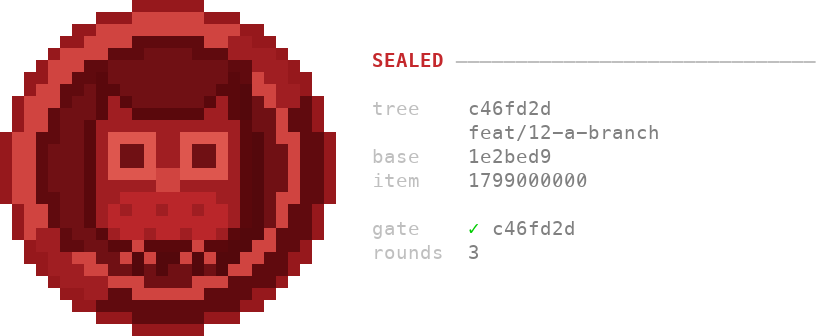

# assets/seals/ — the emblems the stamp has carried

The stamp is the sealer's. It is drawn once per work item, at the commit of
a `guarantee.md` reading `sealed` (`docs/the-review-record.md` *The
stamp*): the panel of what the records at that commit say, and a wax disc
with an emblem pressed into it. Before #975 the broad gate's run drew it
when the run passed. It drew the gold lily, the red lily and, from 0.20.0
through 0.22.0, the placeholder S below, which the sealer's stamp carried
through 0.23.0. From 0.23.1 through 0.25.0 the stamp carried the horned
owl. From 0.25.1 it carries the little owl on a red wax seal. The emblem has
changed since #30 first drew it. This directory keeps each version as the
terminal drew it, so a reader can see an earlier one without checking out an
old tag.

The emblem and its drawings are not licensed under the MIT License that
covers the code. [`TRADEMARKS.md`](../../TRADEMARKS.md) states what they
are under.

Each entry is two files, and no code reads either of them. Each owl's entry
holds a third, an `.svg`, the form a page shows, described in its entry.

- **`<name>.ans`** — the stamp as a terminal prints it: half-block
  characters and ANSI colour codes, a code only where the colour changes.
  Print it with `cat` in a terminal that draws truecolour.
- **`<name>.png`** — a preview of the same cells for a page that cannot
  print ANSI codes. Each cell is 12 × 24 pixels, a half-block is drawn as
  its two halves, and a cell nothing paints is transparent. A character is
  Menlo at 19 pixels, centred in its cell. A 256-colour code is read
  through xterm's table, and the terminal's own foreground is grey, (128,
  128, 128). The text beside the disc, from the placeholder S on, adds
  three styles: bold is Menlo Bold, dim is drawn at half opacity (alpha
  128), and the terminal's green is xterm's (0, 205, 0). No script in the
  tree draws a preview, and the tree installs no imaging library. Redrawn
  by this rule with Pillow 12.3.0 from a throwaway environment, every
  preview of a `.ans` in this directory and in `candidates/` matched its
  file pixel for pixel, and `horned-owl.png` was drawn the same way.
  `owl.png` was drawn by this rule with Pillow 13.0.0, which redraws
  `horned-owl.png` and `placeholder-s.png` pixel for pixel. Each glyph is
  drawn on the whole image, anchored at its cell's centre, so a glyph wider
  than its cell, such as `─`, overlaps the next cell where the two meet.

The source of each entry is its tag, not a copy of the old code. The
command under each entry draws it again from the tag. It loads that tag's
`skills/verify/scripts/seal_stamp.py` and calls `stamp` over the module's
`SAMPLE_ROWS` directly, because `seal stamp` on a pipe prints the letter
twin rather than the colours. Each lily's command passes `DEFAULT_SCALE`
as well. From 0.20.0 the module reads its mark from `seal-mark.txt` beside
it, so the commands of the placeholder S and of both owls write the tag's
`seal-mark.txt` into a temporary directory and point the module there.

## The gold lily — 0.10.0 to 0.16.0


- **Releases:** 0.10.0 through 0.16.0. From 0.15.7 the stamp is drawn at
  0.90 by default (#400); before that, at 1.0. The file is v0.16.0's, at
  0.90.
- **Issue:** #30, through pull request #332. #30 computed the disc from
  its radius, so it cannot be off centre, and the lily was a 29 × 32 chart
  sampled onto it.
- **Draw it again:**

  ```
  git show v0.16.0:skills/verify/scripts/seal_stamp.py | python3 -c 'import sys, types; m = types.ModuleType("seal_stamp"); exec(sys.stdin.read(), m.__dict__); print("\n".join(m.stamp(m.SAMPLE_ROWS, m.DEFAULT_SCALE)))' > gold-lily.ans
  ```

- **Bytes:** v0.16.0's writer sets a colour that is already in force 20
  times. `gold-lily.ans` leaves those 20 codes out, so it is 10,751 bytes
  where the command writes 10,831. Every cell has the same character and
  the same two colours in both.

## The red lily — 0.17.0 to 0.19.0


- **Releases:** 0.17.0 through 0.19.0. The file is v0.19.0's, at its
  default of 0.90.
- **Issue:** #717, through pull request #719. #717 made the stamp a letter
  on a parchment sheet, took the rope and the gold off, and pressed the
  disc over the sheet's corner, so the hook's message fits under the
  harness's size limit again.
- **Draw it again:**

  ```
  git show v0.19.0:skills/verify/scripts/seal_stamp.py | python3 -c 'import sys, types; m = types.ModuleType("seal_stamp"); exec(sys.stdin.read(), m.__dict__); print("\n".join(m.stamp(m.SAMPLE_ROWS, m.DEFAULT_SCALE)))' > red-lily.ans
  ```

- **Bytes:** `red-lily.ans` is exactly what the command writes, 6,455
  bytes.

## The placeholder S — 0.20.0 to 0.23.0


- **Releases:** 0.20.0 through 0.23.0. The disc is the same at every tag
  from v0.20.0 to v0.23.0. The sample panel beside it lost its `ledger` row
  in 0.22.0 (#944) and became the sealer's shorter panel in 0.22.1 (#975).
  The file is v0.22.1's, the last tag when this entry was written.
- **Issue:** #832, through pull request #859. #832 settled the 28-cell
  frame and left the mark a placeholder: Georgia Bold's S, held as a chart
  of 28 lines over `.M` in `skills/verify/scripts/seal-mark.txt`. #857
  replaced it with the horned owl.
- **Draw it again:**

  ```
  python3 -c 'import os, subprocess, tempfile, types; show = lambda p: subprocess.run(["git", "show", "v0.22.1:skills/verify/scripts/" + p], capture_output=True, encoding="utf-8", check=True).stdout; d = tempfile.TemporaryDirectory(); open(os.path.join(d.name, "seal-mark.txt"), "w", encoding="utf-8").write(show("seal-mark.txt")); m = types.ModuleType("seal_stamp"); m.__file__ = os.path.join(d.name, "seal_stamp.py"); exec(show("seal_stamp.py"), m.__dict__); print("\n".join(m.stamp(m.SAMPLE_ROWS)))' > placeholder-s.ans
  ```

- **Bytes:** `placeholder-s.ans` is exactly what the command writes, 5,498
  bytes.

## The horned owl — 0.23.1 to 0.25.0



- **Releases:** 0.23.1 through 0.25.0. The disc's frame is the placeholder
  S's; only the mark changed. The files were drawn from the commit that
  wrote this entry, before v0.23.1 was tagged, and were renamed from
  `owl.*` when the little owl took that name.
- **Issue:** #857. The owner chose the owl on 2026-10-28, over the bee
  below, in two forms that read as one design: a sprite for the terminal's
  grid and a vector for a page, and chose the stamp's reds for the sprite
  over a colour sprite and over a one-colour relief. The owl stands for the
  guarantee, as on an Athenian coin.
- **The terminal's form:** `skills/verify/scripts/seal-mark.txt` at the
  tag, a 16 × 16 sprite drawn one cell at a time, one letter per cell,
  standing six cells in from the disc's left and top edges.
  `seal_stamp.py#SPRITE_COLOURS` at the tag gave each letter's colour,
  every one of them one of the stamp's own reds; `.` was the field, and a
  field cell whose upper-left neighbour was drawn took the drop shadow,
  `DROP`.
- **Draw it again:**

  ```
  python3 -c 'import os, subprocess, tempfile, types; show = lambda p: subprocess.run(["git", "show", "v0.23.1:skills/verify/scripts/" + p], capture_output=True, encoding="utf-8", check=True).stdout; d = tempfile.TemporaryDirectory(); open(os.path.join(d.name, "seal-mark.txt"), "w", encoding="utf-8").write(show("seal-mark.txt")); m = types.ModuleType("seal_stamp"); m.__file__ = os.path.join(d.name, "seal_stamp.py"); exec(show("seal_stamp.py"), m.__dict__); print("\n".join(m.stamp(m.SAMPLE_ROWS)))' > horned-owl.ans
  ```

- **Bytes:** `horned-owl.ans` is exactly what the command writes, 6,199
  bytes.
- **The page's form:** `horned-owl.svg`, a vector seal with the detail an
  image can carry and the sprite has no room for: ringed eyes, the wing
  lines and the chevrons on its breast, in seven reds of its own. From
  0.23.1 through 0.25.0 the plugin's icon, and so each release note's
  `seal.png`, was drawn from it.


## The little owl — from 0.25.1


- **Releases:** 0.25.1 onward. The files were drawn from the commit that
  wrote this entry, before v0.25.1 was tagged.
- **Issue:** #1174. The horned owl's raised head corners read as ear
  tufts, and the little owl of Athena's coin (*Athene noctua*) has none. On
  2026-10-31 the owner chose this round-headed owl for both forms, and a
  red wax seal for the terminal's disc in place of the rim and the groove.
- **The terminal's form:** `skills/verify/scripts/seal-mark.txt`, a 16 ×
  16 sprite drawn one cell at a time, one letter per cell, standing six
  cells in from the disc's left and top edges. `seal_stamp.py#SPRITE_COLOURS`
  gives each letter's colour; `.` is the field, and a field cell whose
  upper-left neighbour is drawn takes the drop shadow, `DROP`. No cell is
  shaded by its neighbours, because shading breaks a mark this small. The
  wax is computed (`seal_stamp.py#build`): an edge that wobbles, a lip lit
  from the upper left with a gloss streak, a step ring lit the other way,
  and the pressed field, every cell one of fifteen colours. The wobble
  leaves the grid's first column and last half-row empty.
- **Draw it again:**

  ```
  python3 -c 'import os, subprocess, tempfile, types; show = lambda p: subprocess.run(["git", "show", "v0.25.1:skills/verify/scripts/" + p], capture_output=True, encoding="utf-8", check=True).stdout; d = tempfile.TemporaryDirectory(); open(os.path.join(d.name, "seal-mark.txt"), "w", encoding="utf-8").write(show("seal-mark.txt")); m = types.ModuleType("seal_stamp"); m.__file__ = os.path.join(d.name, "seal_stamp.py"); exec(show("seal_stamp.py"), m.__dict__); print("\n".join(m.stamp(m.SAMPLE_ROWS)))' > owl.ans
  ```

- **Bytes:** `owl.ans` is exactly what the command writes, 5,931 bytes.
- **The page's form:** `owl.svg`, a vector wax seal with the detail an
  image can carry and the sprite has no room for: a fret border pressed
  into the wax, the owl's ringed eyes and scalloped breast, and the olive
  branch it perches on. It is painted in gradients of red of its own, not in the
  stamp's fifteen colours. The plugin's icon, `.claude-plugin/icon.png`, is
  drawn from it, and the release note's `seal.png` is a copy of that icon
  (`.github/scripts/release_seal.py#draw`). Draw the icon again from the
  repository's top directory with `resvg_py`, the Python binding of the
  resvg renderer, installed in a throwaway environment (`resvg_py` 0.5.0
  drew the committed file):

  ```
  python3 -c 'import resvg_py; open(".claude-plugin/icon.png", "wb").write(bytes(resvg_py.svg_to_bytes(svg_path="assets/seals/owl.svg", width=512, height=512)))'
  ```

- **What nothing checks:** that the icon is still the SVG. An edit to
  `owl.svg` that is not followed by the command above leaves the plugin's
  icon and every later release seal showing the old owl, and the suite
  cannot see it, because comparing the two needs an SVG renderer the suite
  does not have on every operating system it runs on.


## The next entry

The work that ships a new mark writes its entry in the same pull request:
the `.ans` drawn by the entry's command, the `.png` drawn from it by the
preview rule above, and the entry's section. The command names the first
tag that carries the mark. That tag does not exist while the entry is
written, so the files are drawn from the commit that writes them, with the
command's tag replaced by that commit.

## Candidates

The candidates below were drawn on the disc whose frame the owner settled
on 2026-10-07: 28 cells across, a wax edge, a rim lit from the upper left, a
groove and the field. The placeholder S and the horned owl stood on it. The
owner looked at the two section signs the same day and shipped neither, and
on 2026-10-28 kept the horned owl and the bee, then chose the horned owl
(#857). The section signs and the bee stay here. From 0.25.1 the disc is
the red wax seal of #1174, so a candidate taken now would be pressed into
that seal, not into the frame it was drawn on.

Each candidate is three files, and no code reads any of them:

- **`<name>.txt`** — the mark as a chart: `M` where the mark is pressed,
  `.` where the field shows. The bee's is a 16 × 16 sprite instead, one
  letter per cell, read as each owl's is.
- **`<name>.ans`** — the stamp the owner looked at, its caption line
  dropped and its colour codes written only where something changes, so a
  terminal prints it whole. Every cell is the one the owner saw.
- **`<name>.png`** — a preview of the `.ans`, drawn by the rule above.

**The two section signs stand on the parchment sheet, which the owner
retired the same day.** The stamp that ships has no sheet: the disc stands
at the left and the text beside it in the terminal's own colours. So only a
candidate's mark is a candidate; its sheet, its disc and the shape of its
rows are history.

**A sprite becomes the mark by replacing `seal-mark.txt` with it.**
`seal_stamp.py#read_sprite` reads that file when the stamp module loads.
It refuses a file that is not 16 lines of 16 characters over `.` and the
letters of `SPRITE_COLOURS`, or that draws a cell, or casts a shadow,
outside the disc's field, with a sentence naming the first fault. A `.M`
chart is not a sprite, so a section sign would be redrawn as one before it
could become the mark.

### The section sign at 28 cells — `section-28`


- **What it is:** Georgia Bold's section sign, fitted to the 28-cell frame, in the
  red lily's three tones with a drop shadow.
- **Drawn by:** the orchestrating session's reference renderer over a
  sample panel, not by `seal_stamp.py`. No tag draws it again.
- **Its chart had three cells in the groove.** Three `M` cells of its
  first marked line, line 5 at columns 12, 17 and 18, lie in the disc's
  groove. The reference renderer painted the groove over them, so the
  `.ans` shows the mark without them.

### The bee in the stamp's reds — `bee-28-pixel`


- **What it is:** a mark drawn on 2026-10-28 as pixel art, one cell at a
  time, beside the horned owl and the same way: a 16 × 16 sprite at the centre of
  the 28-cell disc, its letters read by `seal_stamp.py#SPRITE_COLOURS`, so
  every colour is one of the stamp's own reds.
- **Why it was kept:** the bee stands for workers who need no one to tell
  them what to do, and for the wax a seal is pressed in. The owner chose
  the horned owl over it in #857.
- **What it would take:** `bee-28-pixel.txt` replacing `seal-mark.txt`.
  `read_sprite` accepts it as it stands.
- **What a page shows:** `bee-web.svg`, a faceted bee inside a hexagonal
  wax cell, the honeycomb its sprite has no room for, with a `.png` preview
  beside it.


### The light-red section sign at 14 cells — `section-14-light-red`


- **What it is:** a hand-drawn 7 × 10 chart of the section sign in one light red,
  (240, 130, 118), with a one-cell shadow, on a 14-cell disc of four flat
  colours, standing inside the sheet against its right edge. The owner
  printed it and accepted it, then chose the 28-cell frame the same day.
- **Where it was:** the stamp this work item drew from 35277597 until
  32e257f7 replaced it. No release carried it.
- **Its chart** is the 14 × 14 grid the 7 × 10 chart filled at 35277597,
  two lines down and four columns in. #857's own lesson is that a mark
  scaled by ratio smears: it would be redrawn as a 16-cell sprite, not
  enlarged.
- **Draw it again:** the `.ans` is that commit's stamp over the hook test
  module's `FULL_ROWS`, the real `fitted` panel the owner printed. The
  command writes 3,002 bytes where the file holds 2,954, because the file
  writes a code only where something changes; every cell is the same.

  ```
  python3 -c 'import ast, subprocess, types; show = lambda p: subprocess.run(["git", "show", "35277597:" + p], capture_output=True, encoding="utf-8").stdout; m = types.ModuleType("seal_stamp"); exec(show("skills/verify/scripts/seal_stamp.py"), m.__dict__); rows = next(ast.literal_eval(n.value) for n in ast.parse(show("tests/behaviour/test_the_stamp_reaches_the_person_it_is_drawn_for.py")).body if isinstance(n, ast.Assign) and getattr(n.targets[0], "id", "") == "FULL_ROWS"); print("\n".join(m.stamp(rows, m.DEFAULT_SCALE)))' > section-14-light-red.ans
  ```
