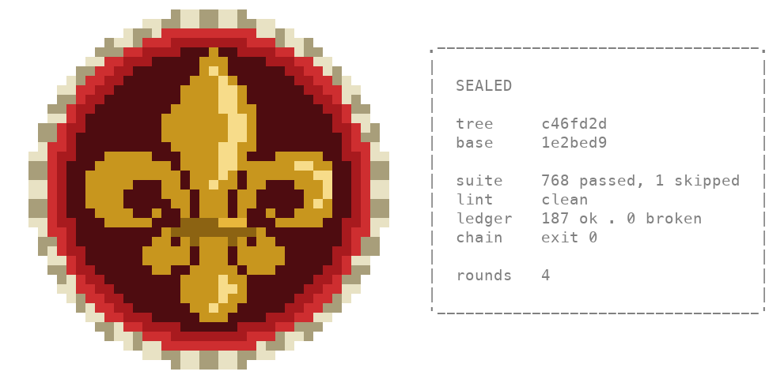
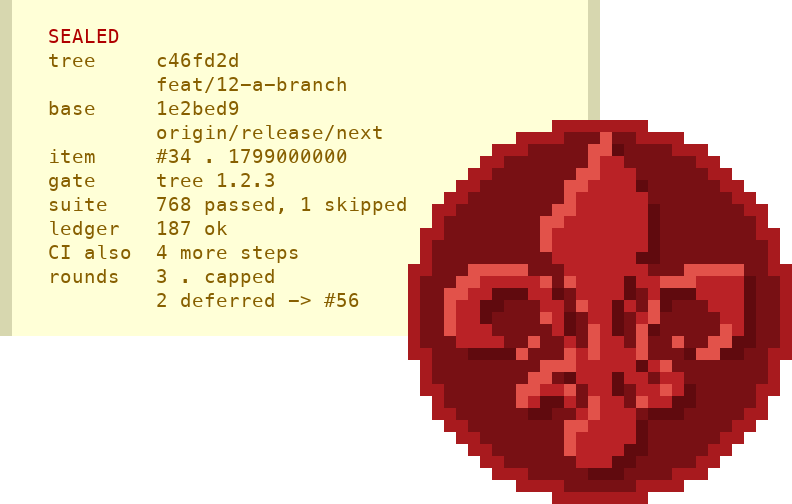
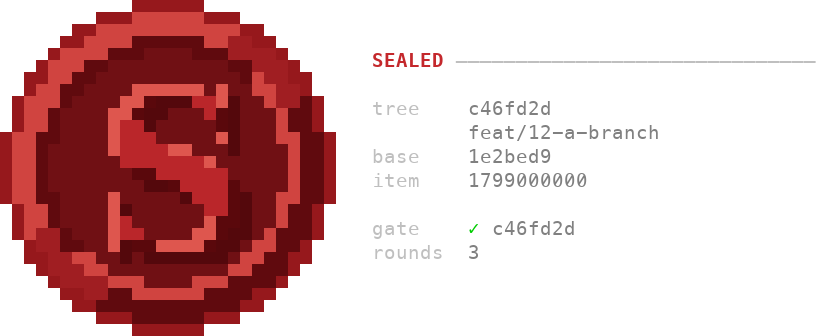
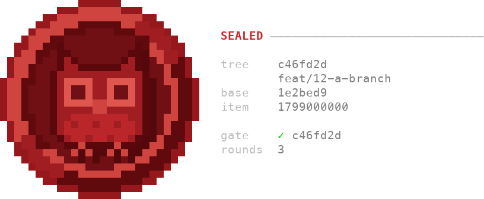
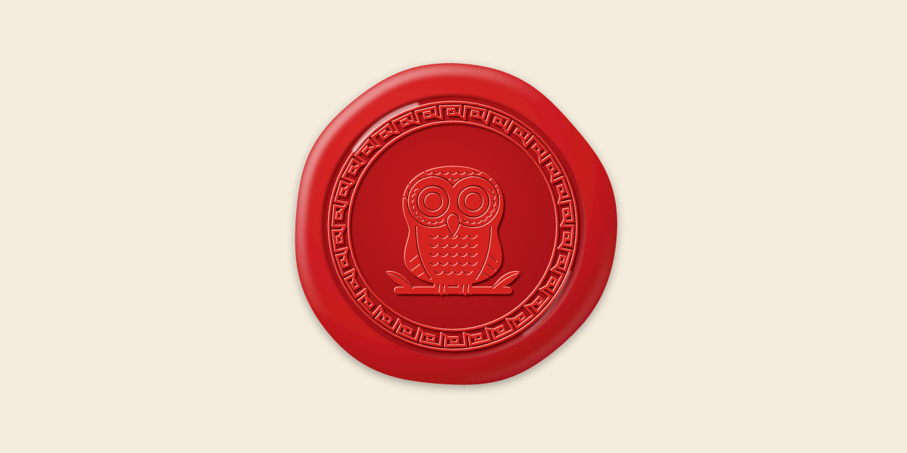

# assets/seals/ — the emblems the stamp has carried

The stamp is the sealer's. It is drawn once per work item, at the commit of
a `guarantee.md` reading `sealed` (`docs/checks/the-stamp.md` *The
stamp*): the panel of what the records at that commit say, and a wax disc
with an emblem pressed into it. Before #975 the broad gate's run drew it
when the run passed. It drew the gold lily, the red lily and, from 0.20.0
through 0.22.0, the placeholder S below, which the sealer's stamp carried
through 0.23.0. From 0.23.1 through 0.25.0 the stamp carried the horned
owl. From 0.25.1 it carries the little owl on a red wax seal. The emblem has
changed since #30 first drew it. This directory keeps each version as the
terminal drew it, so a reader can see an earlier one without checking out an
old tag.

The emblem and its drawings are not licensed under the MIT License that
covers the code. [`TRADEMARKS.md`](../../TRADEMARKS.md) states what they
are under.

Each entry is two files, and no code reads either of them. Each owl's entry
holds a third, an `.svg`, the form a page shows, and the little owl's holds
the social preview's `.svg` and `.png` and two drawings of the directory
icon besides, each described in its entry.

- **`<name>.ans`** — the stamp as a terminal prints it: half-block
  characters and ANSI colour codes, a code only where the colour changes.
  Print it with `cat` in a terminal that draws truecolour.
- **`<name>.png`** — a preview of the same cells for a page that cannot
  print ANSI codes. Each cell is 12 × 24 pixels, a half-block is drawn as
  its two halves, and a cell nothing paints is transparent. A character is
  Menlo at 19 pixels, centred in its cell. A 256-colour code is read
  through xterm's table, and the terminal's own foreground is grey, (128,
  128, 128). The text beside the disc, from the placeholder S on, adds
  three styles: bold is Menlo Bold, dim is drawn at half opacity (alpha
  128), and the terminal's green is xterm's (0, 205, 0). No script in the
  tree draws a preview, and the tree installs no imaging library. Redrawn
  by this rule with Pillow 12.3.0 from a throwaway environment, the
  previews of the gold lily, the red lily and the placeholder S each
  matched its `.ans` pixel for pixel, and `horned-owl.png` was drawn the
  same way. `owl.png` was drawn by this rule with Pillow 13.0.0, which
  redraws `horned-owl.png` and `placeholder-s.png` pixel for pixel. Each
  glyph is drawn on the whole image, anchored at its cell's centre, so a
  glyph wider than its cell, such as `─`, overlaps the next cell where the
  two meet.

The source of each entry is its tag, not a copy of the old code. The
command under each entry draws it again from the tag. It loads that tag's
`skills/verify/scripts/seal_stamp.py` and calls `stamp` over the module's
`SAMPLE_ROWS` directly, because `seal stamp` on a pipe prints the letter
twin rather than the colours. Each lily's command passes `DEFAULT_SCALE`
as well. From 0.20.0 the module reads its mark from `seal-mark.txt` beside
it, so the commands of the placeholder S and of both owls write the tag's
`seal-mark.txt` into a temporary directory and point the module there.

## The gold lily — 0.10.0 to 0.16.0



- **Releases:** 0.10.0 through 0.16.0. From 0.15.7 the stamp is drawn at
  0.90 by default (#400); before that, at 1.0. The file is v0.16.0's, at
  0.90.
- **Issue:** #30, through pull request #332. #30 computed the disc from
  its radius, so it cannot be off centre, and the lily was a 29 × 32 chart
  sampled onto it.
- **Draw it again:**

  ```
  git show v0.16.0:skills/verify/scripts/seal_stamp.py | python3 -c 'import sys, types; m = types.ModuleType("seal_stamp"); exec(sys.stdin.read(), m.__dict__); print("\n".join(m.stamp(m.SAMPLE_ROWS, m.DEFAULT_SCALE)))' > gold-lily.ans
  ```

- **Bytes:** v0.16.0's writer sets a colour that is already in force 20
  times. `gold-lily.ans` leaves those 20 codes out, so it is 10,751 bytes
  where the command writes 10,831. Every cell has the same character and
  the same two colours in both.

## The red lily — 0.17.0 to 0.19.0



- **Releases:** 0.17.0 through 0.19.0. The file is v0.19.0's, at its
  default of 0.90.
- **Issue:** #717, through pull request #719. #717 made the stamp a letter
  on a parchment sheet, took the rope and the gold off, and pressed the
  disc over the sheet's corner, so the hook's message fits under the
  harness's size limit again.
- **Draw it again:**

  ```
  git show v0.19.0:skills/verify/scripts/seal_stamp.py | python3 -c 'import sys, types; m = types.ModuleType("seal_stamp"); exec(sys.stdin.read(), m.__dict__); print("\n".join(m.stamp(m.SAMPLE_ROWS, m.DEFAULT_SCALE)))' > red-lily.ans
  ```

- **Bytes:** `red-lily.ans` is exactly what the command writes, 6,455
  bytes.

## The placeholder S — 0.20.0 to 0.23.0



- **Releases:** 0.20.0 through 0.23.0. The disc is the same at every tag
  from v0.20.0 to v0.23.0. The sample panel beside it lost its `ledger` row
  in 0.22.0 (#944) and became the sealer's shorter panel in 0.22.1 (#975).
  The file is v0.22.1's, the last tag when this entry was written.
- **Issue:** #832, through pull request #859. #832 settled the 28-cell
  frame and left the mark a placeholder: Georgia Bold's S, held as a chart
  of 28 lines over `.M` in `skills/verify/scripts/seal-mark.txt`. #857
  replaced it with the horned owl.
- **Draw it again:**

  ```
  python3 -c 'import os, subprocess, tempfile, types; show = lambda p: subprocess.run(["git", "show", "v0.22.1:skills/verify/scripts/" + p], capture_output=True, encoding="utf-8", check=True).stdout; d = tempfile.TemporaryDirectory(); open(os.path.join(d.name, "seal-mark.txt"), "w", encoding="utf-8").write(show("seal-mark.txt")); m = types.ModuleType("seal_stamp"); m.__file__ = os.path.join(d.name, "seal_stamp.py"); exec(show("seal_stamp.py"), m.__dict__); print("\n".join(m.stamp(m.SAMPLE_ROWS)))' > placeholder-s.ans
  ```

- **Bytes:** `placeholder-s.ans` is exactly what the command writes, 5,498
  bytes.

## The horned owl — 0.23.1 to 0.25.0



- **Releases:** 0.23.1 through 0.25.0. The disc's frame is the placeholder
  S's; only the mark changed. The files were drawn from the commit that
  wrote this entry, before v0.23.1 was tagged, and were renamed from
  `owl.*` when the little owl took that name.
- **Issue:** #857. The owner chose the owl on 2026-10-28, over the bee,
  in two forms that read as one design: a sprite for the terminal's grid
  and a vector for a page, and chose the stamp's reds for the sprite over
  a colour sprite and over a one-colour relief. The owl stands for the
  guarantee, as on an Athenian coin.
- **The terminal's form:** `skills/verify/scripts/seal-mark.txt` at the
  tag, a 16 × 16 sprite drawn one cell at a time, one letter per cell,
  standing six cells in from the disc's left and top edges.
  `seal_stamp.py#SPRITE_COLOURS` at the tag gave each letter's colour,
  every one of them one of the stamp's own reds; `.` was the field, and a
  field cell whose upper-left neighbour was drawn took the drop shadow,
  `DROP`.
- **Draw it again:**

  ```
  python3 -c 'import os, subprocess, tempfile, types; show = lambda p: subprocess.run(["git", "show", "v0.23.1:skills/verify/scripts/" + p], capture_output=True, encoding="utf-8", check=True).stdout; d = tempfile.TemporaryDirectory(); open(os.path.join(d.name, "seal-mark.txt"), "w", encoding="utf-8").write(show("seal-mark.txt")); m = types.ModuleType("seal_stamp"); m.__file__ = os.path.join(d.name, "seal_stamp.py"); exec(show("seal_stamp.py"), m.__dict__); print("\n".join(m.stamp(m.SAMPLE_ROWS)))' > horned-owl.ans
  ```

- **Bytes:** `horned-owl.ans` is exactly what the command writes, 6,199
  bytes.
- **The page's form:** `horned-owl.svg`, a vector seal with the detail an
  image can carry and the sprite has no room for: ringed eyes, the wing
  lines and the chevrons on its breast, in seven reds of its own. From
  0.23.1 through 0.25.0 the plugin's icon, and so each release note's
  `seal.png`, was drawn from it.


## The little owl — from 0.25.1


- **Releases:** 0.25.1 onward. The files were drawn from the commit that
  wrote this entry, before v0.25.1 was tagged.
- **Issue:** #1174. The horned owl's raised head corners read as ear
  tufts, and the little owl of Athena's coin (*Athene noctua*) has none. On
  2026-10-31 the owner chose this round-headed owl for both forms, and a
  red wax seal for the terminal's disc in place of the rim and the groove.
- **The terminal's form:** `skills/verify/scripts/seal-mark.txt`, a 16 ×
  16 sprite drawn one cell at a time, one letter per cell, standing six
  cells in from the disc's left and top edges. `seal_stamp.py#SPRITE_COLOURS`
  gives each letter's colour; `.` is the field, and a field cell whose
  upper-left neighbour is drawn takes the drop shadow, `DROP`. No cell is
  shaded by its neighbours, because shading breaks a mark this small. The
  wax is computed (`seal_stamp.py#build`): an edge that wobbles, a lip lit
  from the upper left with a gloss streak, a step ring lit the other way,
  and the pressed field, every cell one of fifteen colours. The wobble
  leaves the grid's first column and last half-row empty.
- **Draw it again:**

  ```
  python3 -c 'import os, subprocess, tempfile, types; show = lambda p: subprocess.run(["git", "show", "v0.25.1:skills/verify/scripts/" + p], capture_output=True, encoding="utf-8", check=True).stdout; d = tempfile.TemporaryDirectory(); open(os.path.join(d.name, "seal-mark.txt"), "w", encoding="utf-8").write(show("seal-mark.txt")); m = types.ModuleType("seal_stamp"); m.__file__ = os.path.join(d.name, "seal_stamp.py"); exec(show("seal_stamp.py"), m.__dict__); print("\n".join(m.stamp(m.SAMPLE_ROWS)))' > owl.ans
  ```

- **Bytes:** `owl.ans` is exactly what the command writes, 5,931 bytes.
- **The page's form:** `owl.svg`, a vector wax seal with the detail an
  image can carry and the sprite has no room for: a fret border pressed
  into the wax, the owl's ringed eyes and scalloped breast, and the olive
  branch it perches on. It is painted in gradients of red of its own, not in the
  stamp's fifteen colours. The plugin's icon, `.claude-plugin/icon.png`, is
  drawn from it, and the release note's `seal.png` is a copy of that icon
  (`.github/scripts/release_seal.py#draw`). Draw the icon again from the
  repository's top directory with `resvg_py`, the Python binding of the
  resvg renderer, installed in a throwaway environment (`resvg_py` 0.5.0
  drew the committed file):

  ```
  python3 -c 'import resvg_py; open(".claude-plugin/icon.png", "wb").write(bytes(resvg_py.svg_to_bytes(svg_path="assets/seals/owl.svg", width=512, height=512)))'
  ```

- **What nothing checks:** that the icon is still the SVG. An edit to
  `owl.svg` that is not followed by the command above leaves the plugin's
  icon and every later release seal showing the old owl, and the suite
  cannot see it, because comparing the two needs an SVG renderer the suite
  does not have on every operating system it runs on.


- **The social preview:** `owl-social.png`, the image a page shows beside
  a shared link to the repository. It is 1280 × 640 pixels and under 1 MB,
  on the solid background GitHub's guidance recommends. Its source is
  `owl-social.svg`, which places `owl.svg` by `<image href="owl.svg">`,
  480 pixels square and centred, on a solid `#f4ecdc` field, and copies
  none of the owl's paths. GitHub reads no file in the tree for the
  preview: the owner uploads the PNG in the repository's settings, under
  General, Social preview. Draw it again from the repository's top
  directory with the same `resvg_py` 0.5.0 (it drew the committed file):

  ```
  python3 -c 'import resvg_py; open("assets/seals/owl-social.png", "wb").write(bytes(resvg_py.svg_to_bytes(svg_path="assets/seals/owl-social.svg", resources_dir="assets/seals")))'
  ```

  `resources_dir` is the directory the `href` is read against. Without it,
  resvg draws the field alone and still exits 0. Nothing checks that the
  preview is still the SVG, for the reason nothing checks the icon. Nor
  does anything check that the image the repository's settings hold is
  the committed file: an edit to `owl.svg` is followed by this command and
  by a new upload, or the shared link shows the old owl.



- **The directory icon:** `owl-icon-cream.svg` and `owl-icon-coral.svg`,
  each with the `.png` drawn from it at 512 × 512 pixels. The plugin
  directory lists each plugin in a small tile, where the fret border, the
  scallops and the thin lines of `owl.svg` blur together. These two keep the
  seal's wax outline, copied from `owl.svg`'s outer path, and its darker
  pressed disc, and draw the owl again in flat shapes with fewer, thicker
  lines: the ringed eyes, the beak, one wing line on each side, two rows of
  breast scallops and the branch. The fret border is one plain ring. The two
  differ only in the owl's colour, cream or a light red. The directory reads
  no file in the tree for this tile: the owner uploads the PNG in the
  directory's form, and the cream one is the one uploaded. The plugin's
  icon, `.claude-plugin/icon.png`, stays the drawing of `owl.svg`, because
  every release seal is a copy of it. Draw each PNG again from the
  repository's top directory with `rsvg-convert` (librsvg 2.58.4 drew the
  committed files):

  ```
  rsvg-convert -w 512 -h 512 assets/seals/owl-icon-cream.svg -o assets/seals/owl-icon-cream.png
  ```

  Nothing checks that the image the directory holds is the committed file,
  for the reason given for the social preview.


## The next entry

The work that ships a new mark writes its entry in the same pull request:
the `.ans` drawn by the entry's command, the `.png` drawn from it by the
preview rule above, and the entry's section. The command names the first
tag that carries the mark. That tag does not exist while the entry is
written, so the files are drawn from the commit that writes them, with the
command's tag replaced by that commit.
